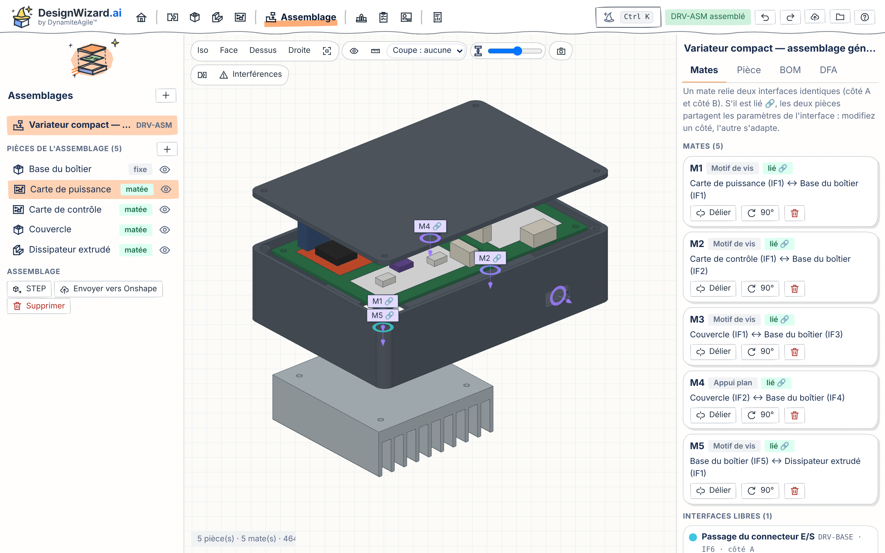

# DesignWizard.ai <sub>by DynamiteAgile™</sub>

**De l'intention à la pièce, de la pièce au système — la conception mécatronique réinventée, ouverte.**

L'objectif : **commander en quelques jours des pièces faisables, prototyper la physique d'un produit, l'essayer au
laboratoire** — et fermer la boucle de conception avant de lancer la production. Une pièce ne naît pas d'une esquisse
extrudée : elle naît de son **intention** — ses interfaces, sa matière, sa matière première — comme dans l'atelier
d'un artisan, aidé par l'IA. Les règles DFM, DFA, DFx et d'isolation s'appliquent dès la première minute.

Libre sous **licence MIT**. Tout tourne dans le navigateur ; vos fichiers restent chez vous.

> Dix-septième itération (v0.17.0 : dessins au format tabloïd — notes en bas à gauche, vues centrées, isométrique en haut à droite, chaque cote avec sa bulle, classes référence / SC / CSC, ASME Y14.5, dessin d'assemblage avec repères et nomenclature ; révisions suivies de la pièce à l'assemblage ; v0.16.0 : itérations MVP — geler, passer en revue par un dossier IA ou devant les collègues, clore, et mesurer la convergence des formes, des dimensions, des fonctions et des interfaces vers le TRL visé ; v0.15.0 : profilé extrudé qui se dessine autour de ce qu'il contient, chaque glissière étant une interface ; santé des accouplements — sain, à vérifier, rompu ; vue normale à une face ; Isolation : masquer et ramener les corps, rôles et potentiels au clic droit ; v0.14.1 : les joints — registre numéroté, interfaces internes ou externes, joint collé à film calé, boîtier et couvercle assemblés et contrôlés seuls ; v0.13 : moulage — dépouille réelle dans la géométrie, couvercle assorti au boîtier, fermeture par clips, platine nervurée ; v0.12 : la souris et les raccourcis dans toutes les vues 3D — sélection, mesure, clic droit ; v0.11 : l'analyse fonctionnelle s'échange avec DynamiteAgile dans son propre format de fichier ; v0.10 : un premier design complet demandé à une IA par entrevue, et la revue de conception qui le suit, artéfact par artéfact ; v0.9 : la pièce moulée, plastique ou métal, qui se dessine d'elle-même avec les règles du mouleur ; v0.8 : le modèle 3D sous la souris — sélection, clic droit, raccourcis, symboles de simulation ; v0.7 : garde-fous de co-intelligence et exports draw.io à la façon de DynamiteAgile ; v0.6 : tracé de piste à la main et routeur plus tenace ; v0.5 : bibliothèque PCBA étendue, blocs qui se déplacent avec leurs pistes ; v0.4 : gammes de fabrication et d'assemblage ; v0.3 : simulation, carte électronique, aller-retour IA), publiée pour recueillir vos commentaires. Voir [Vos commentaires](#vos-commentaires),
> la [vision](docs/VISION.md) et le [format de fichier `.dwiz`](docs/FORMAT.md).
> *English summary at the [end of this page](#english-summary).*

## Aperçu

| | |
|---|---|
|  |  |
| **Atelier** (*Shop*) — intention, interfaces par leur forme, matière première : la pièce se construit, avec sa gamme | **Commander** — prête à commander ? en combien de jours ? Le dossier pour l'atelier en un clic |
|  |  |
| **Physique** — 21 modèles simples et reconnus : 80 % de la réponse en une seconde | **Assemblage** — les pièces s'accouplent par leurs interfaces et restent liées |
|  |  |
| **Isolation** — distances requises et chemins mesurés sur l'assemblage | **Thèmes** — Le.Carnet, Mécanique, Aéronautique, Spatial |


Une pièce, dans le format de la plateforme (`.dwiz`) — une instruction par ligne, lisible par l'ingénieur, l'atelier
et l'IA :

```text
dwiz part/1 PN-0042 "Plaque d'adaptation"
function "Porte le capteur sur le bâti."
interface IF1 bolt_pattern side=A face=-Z at=[L/2, W/2] key=frame_mount partner=Bâti
  params screw=M5 pattern={type: rect, nx: 2, ny: 2, dx: 80, dy: 50}
material AL6061-T6
stock plate L=L W=W t=t
param L 105 min=105 max=400 unit=mm label=Longueur
param W = 75
param t = 5
do outline profile={rect: [0, 0, L, W], r: 4}
do interfaces
do deburr
```

## Démarrer en deux minutes

Il faut Python 3.9 ou plus récent (bibliothèque standard seulement) et un navigateur récent (essayé sous Chrome et
Edge ; Firefox et Safari restent à essayer).

```bash
git clone https://github.com/jpdesbiens11/DesignWizard.ai.git
```

```bash
cd DesignWizard.ai
```

```bash
python designwizard.py
```

Le navigateur s'ouvre sur `http://127.0.0.1:8070`. Cliquez **« Charger la démonstration Variateur 400 V »**.
Rien n'est installé, rien n'est téléchargé : le noyau CAO (OpenCascade en WebAssembly) et la vue 3D sont dans le dépôt.

Sans Python, le dossier `web/` fonctionne aussi tel quel derrière n'importe quel serveur de fichiers statiques
(les projets restent alors dans le navigateur, et l'envoi vers Onshape n'est pas disponible).

## Le parcours

| Onglet | Ce que vous y faites |
|---|---|
| **Atelier** (*Shop*) | Vous dites l'**intention** : à quoi sert la pièce, ses interfaces (par leur forme : « je me visse sur… », « je reçois un arbre »…), sa matière, ce que l'on prend **sur l'étagère** (plaque, tôle, rond, cornière…). La pièce se construit sous vos yeux : plus petite enveloppe, épaisseur du commerce, **gamme de fabrication**, verdict DFx et délai de prototype. **Pièce moulée** : vous donnez le volume à contenir et ce qui se fixe dedans ; la coque se dessine seule avec les règles du mouleur — paroi unique choisie pour la matière et la longueur d'écoulement, rayons, bossages détachés et noyautés, goussets, nervures, inserts (plastique) ou taraudages repris (métal), **dépouille réelle dans le modèle** ; trois pièces — la coque qui contient, le **couvercle assorti** qui la ferme (par vis ou par **clips**), la **platine nervurée** qui porte ; injection, fonderie sous pression ou par gravité selon la matière ([MOULAGE.md](docs/MOULAGE.md)). Sous-onglets : **entrevue avec Claude** (prompt générique, réponse collée) et registre des interfaces. Un **profilé extrudé** se dessine autour de ce qu'il contient (cartes glissées, modules posés) : chaque glissière est une interface que la pièce glissée reprend ([EXTRUSION.md](docs/EXTRUSION.md)). |
| **Pièces** | Studio de pièce : curseurs sur chaque paramètre (reconstruction en direct), arbre de construction avec **verbes d'atelier** (percer, tarauder, lamer, épauler, charioter…), « Trou ici » / « Interface ici » en cliquant une face, DFM en direct avec **correctifs en un clic**. Onglets **Gamme** (brut, opérations, outils), **Artéfacts** (STEP, STL, DXF, PDF, FeatureScript, **dossier de commande**) et **Fichier** (`.dwiz`). **Tout se fait aussi à la souris sur le modèle** : un clic sélectionne une face, une arête ou un point (Ctrl + clic pour plusieurs) et en donne la mesure ; le clic droit ouvre le menu de ce qui se fait là (trou, poche, bossage, interface, congé, chanfrein, coupe à ce niveau…) ; les raccourcis usuels font de même (H, P, B, I, R, C, N, Échap). Une face nommée dans un dialogue s'allume, et se choisit d'un clic dans la vue. |
| **Extrusion** | Profilés aluminium ou plastique : vous listez ce qui va *dedans* et *dehors*, Claude propose la section, la plateforme l'extrude et vérifie parois, gorges, cavités et cercle circonscrit. |
| **PCB** | Cartes : composants avec leurs hauteurs, zones de cuivre HV / LV, nets. La carte se fixe par ses interfaces comme une autre pièce. |
| **Assemblage** | Ajoutez les pièces : les interfaces identiques (côté A et côté B) **se matent seules** et restent **liées** — changez un côté, l'autre pièce s'adapte. Chaque liaison est un **joint numéroté** (boulonné, collé, encliqueté…) avec ce qui le tient — vis, inserts ou colle, tirés des interfaces ; une interface peut être **externe** (le contrat avec l'extérieur du produit) ; les interférences sont cherchées après chaque montage ([JOINTS.md](docs/JOINTS.md)). Vue éclatée, BOM avec la visserie déduite, interférences, pièce complémentaire générée d'une interface libre. Chaque joint porte sa **santé** — sain, à vérifier, rompu — avec ses raisons en clair, et la touche N place la vue **normale à la face** choisie (N encore : l'autre côté). |
| **PCBA** | Une **carte électronique conçue à partir de ses fonctions** : chaque fonction reçoit un bloc de circuit pris dans la bibliothèque du métier (106 composants, 44 blocs dimensionnés : USB-C, alimentations, moteurs, relais, entrées protégées ou isolées, mémoires, liaisons série…), l'outil en tire composants et nets, propose l'implantation conceptuelle (une zone par bloc) puis le layout détaillé (placement, routage 2 ou 4 couches, **tracé de piste à la main** avec contrôle des règles en direct ; **un bloc se glisse d'une pièce : ses pistes internes le suivent et ses liaisons avec le reste se refont seules**), vérifie 40 règles (électriques, conception, DFM / DFA / DFT) et sort le dossier de fabrication : Gerber, perçage, placement, nomenclature, vernis de tropicalisation. Rapports de revue préliminaire et détaillée en Word et PDF. Un diagramme montre où l'on en est ; les vues d'un outil ECAD classique restent à un clic. Voir [docs/PCBA.md](docs/PCBA.md). |
| **Gammes** (onglet « Gamme » des pièces et des assemblages, étape « Fabrication » du PCBA) | **Fabrication pas à pas** pour parler avec le fournisseur — phases, prise de pièce, opérations, outils, contrôles, caractéristiques à tenir, questions à poser ; un clic montre la pièce telle qu'elle est après chaque phase. **Assemblage pas à pas** pour parler avec le prototypage — une étape par pièce, vis, couples, clés, ordre modifiable, le produit montré à chaque étape ; et la gamme d'assemblage de la carte. Notes par phase gardées dans l'artéfact ; sorties Word, PDF et texte. Voir [docs/GAMMES.md](docs/GAMMES.md). |
| **Aller-retour IA** (étincelle, barre du haut) | Tout artéfact — pièce, assemblage, carte, projet entier — s'exporte en `.dwiz` avec une demande formulée comme à un technicien ; la réponse se réimporte, l'écran liste chaque changement et ce que les vérifications refusent, l'humain applique ou non, en une étape annulable. Voir [docs/IA.md](docs/IA.md). Mêmes garde-fous que la plateforme DynamiteAgile : ce qu'une IA ajoute à l'arbre fonctionnel d'une carte arrive en **« Brouillon IA »** jusqu'à confirmation par un humain, une norme qu'elle cite attend son édition et sa clause, un numéro de fonction n'est jamais réutilisé ; l'arbre des fonctions et la structure fonctionnelle s'exportent en **draw.io** modifiable. |
| **Physique → Simulation** | Éléments finis **volontairement simples**, structure et thermique : la pièce ou l'assemblage est maillé en cubes identiques, tenu et chargé par ses faces ou ses interfaces. Trois physiques : structure, thermique, et **thermo-mécanique** (la dilatation d'une pièce tenue). **Avant de calculer**, l'écran écrit le calcul à la main du modèle simple équivalent (poutre, barre, conduction, bilan de convection, dilatation libre et borne de bridage) ; **après**, il compare les deux. Voir [docs/SIMULATION.md](docs/SIMULATION.md). |
| **Physique** | 21 modèles analytiques — poutres, flambage, torsion, plaque, assemblage boulonné, emmanchement, écoulement en conduite, conduction, dissipateur, busbar, piste de PCB… Les cotes sont reprises de la pièce ; le calcul est montré pas à pas, avec ses hypothèses, son domaine de validité et sa source. |
| **Isolation** | Creepage et clearance mesurés sur **l'assemblage complet**, comparés aux distances requises par IEC 60664-1 (pollution degree, altitude, OVC, system IT). Chemins tracés en rouge. Clic droit sur un corps : le masquer (il reste dans l'arbre, d'où on le ramène), lui donner son rôle et son potentiel — plusieurs niveaux (3,3 V, 5 V, 12 V, 48 V, HV) cohabitent dans un même assemblage. |
| **Revue** | La **revue de conception** de tout le projet : chaque pièce, assemblage, carte et analyse avec son état (« Brouillon IA », « À réviser », « Revu », « Modifié depuis la revue »), sa révision, ce que l'outil y constate et votre note. Une IA écrit le **premier design complet** après une entrevue (Accueil → « Premier design avec une IA… ») ; vous révisez une pièce à la fois ou relancez une **itération complète**, avec la liste des changements avant d'appliquer ([IA.md](docs/IA.md)). Les **itérations MVP** s'y tiennent aussi : chaque MVP est gelé, passé en revue (dossier détaillé pour une IA, ou devant les collègues) et clos avant le suivant, et la convergence se mesure d'une itération à l'autre ([ITERATIONS.md](docs/ITERATIONS.md)). |
| **DFx** | Bilan DFM de chaque pièce, DFA de chaque assemblage, livre des règles imprimable (119 règles, dont celles de la fonderie). |
| **Dessins** | Dessin 2D généré : vues à arêtes cachées, tableau des trous, références A / B / C et **GD&T calculé depuis les interfaces**, cartouche, notes — en PDF vectoriel. Feuille **tabloïd** (11 × 17 po) : notes en bas à gauche, vues centrées, isométrique en haut à droite ; chaque cote porte sa **bulle**, et le volet de gauche la classe — normale, référence ( ), **SC**, **CSC** ; un **assemblage** a ses repères et sa nomenclature au-dessus du cartouche ([DESSINS.md](docs/DESSINS.md)). |
| **Rapport** | Le dossier de revue de conception : images, BOM, interfaces, physique, isolation, constats, matière première, verdict de commande, dessins, décisions et actions. |
| **Compte** (menu) | Connexion Google : en ligne, **votre Google Drive est le stockage de l'application** — un dossier par produit, rangé par numéro (pièces, assemblages, analyses, rapports, commandes). Thèmes. Pour l'administrateur : comptes approuvés de la démo en ligne. Voir [docs/GOOGLE.md](docs/GOOGLE.md). |
| **Onshape** (menu) | Connexion du compte, choix du document, puis envoi : STEP converti en Part Studios et assemblage natifs, dessin PDF et dessin natif Onshape de chaque pièce. |

Partout : **Ctrl + K** ouvre *la baguette* (« 4 trous M4 aux coins à 8 mm », « congé 3 vertical », « longueur 150 »…),
**Ctrl + Z** annule, et **Ctrl + V** hors d'un champ importe ce que vous collez (fichier `.dwiz`, réponse d'entrevue, pièce, profil, STEP).

## Ce qui est vérifié, et comment

- **270 tests Node** (`node --test tests/node/*.test.mjs`) : noyau CAO réel, matière première et verbes d'atelier,
  synthèse de pièce depuis l'intention, format `.dwiz` (aller-retour sans perte sur toutes les pièces), 21 modèles de
  physique contre des valeurs de manuel, exports STL / DXF / FeatureScript, commande et délais, règles IEC 60664-1,
  moteur de chemins, moteur DFx, dessins PDF, connexion Google et Drive (contre des doubles, sans réseau).
  **19 tests Python** (`python -m unittest discover -s tests/py -t .`) : serveur, proxy Onshape.
- **Physique** : modèles analytiques à solution exacte ; propriétés de matériaux **typiques**, à confirmer avec la
  fiche de la nuance. Ils disent si la physique fonctionne ; l'essai en laboratoire le confirme.
- **Délais de commande** : ordres de grandeur d'ateliers de prototypage rapide ; le devis de l'atelier fait foi.
- **FeatureScript** : généré et vérifié par une émulation des opérations sur le noyau, **jamais exécuté dans Onshape**.
- **Google** : connexion, Drive comme stockage de l'application en ligne et porte d'accès vérifiés contre un Google
  simulé ; **à confirmer sur le site publié**. L'identifiant client est en place (celui du projet Google du
  propriétaire, voir [docs/GOOGLE.md](docs/GOOGLE.md)).
- **Isolation** : le moteur de chemins reproduit le produit d'exemple DEMO-HVB de la formation Creepage & Clearance,
  dont les distances sont connues par construction (clearance 16,56 mm et creepage 26 mm entre HV+ et HV−, etc.).
  Chargez « DEMO-HVB » depuis l'accueil pour le voir.
- **Onshape** : l'envoi est testé contre un serveur Onshape simulé. **Il n'a pas encore été exécuté sur un vrai compte** :
  faites le premier essai sur un document de test. Voir [docs/ONSHAPE.md](docs/ONSHAPE.md).
- **Tables IEC 60664-1** : saisies d'après les tables publiées ; à vérifier contre votre copie de la norme avant toute
  décision de certification.

## Vos commentaires

Cette version existe pour être critiquée. Ce qui nous aide le plus :

1. Ce que vous vouliez faire, ce que vous avez fait, ce qui s'est passé.
2. Le projet exporté (menu **Projet → Exporter**) et une image de la vue (bouton appareil photo).
3. Ce qui vous a surpris — en bien ou en mal — dans le parcours « interfaces d'abord ».

Ouvrez un ticket : [Retour d'essai, bogue ou idée](https://github.com/jpdesbiens11/DesignWizard.ai/issues/new/choose).
Le guide complet est dans [docs/GUIDE_COLLABORATEURS.md](docs/GUIDE_COLLABORATEURS.md).

## Documentation

- [docs/VISION.md](docs/VISION.md) — l'objectif, le principe « intention d'abord », les briques technologiques, le « modèle Linux ».
- [docs/FORMAT.md](docs/FORMAT.md) — le format `.dwiz` : notation, genres de document, noms réservés aux modules à venir.
- [docs/GUIDE_COLLABORATEURS.md](docs/GUIDE_COLLABORATEURS.md) — un essai guidé de 20 minutes et comment donner son avis.
- [docs/PART_LANGUAGE.md](docs/PART_LANGUAGE.md) — le vocabulaire d'une pièce : ce que Claude écrit et que la plateforme construit.
- [docs/SIMULATION.md](docs/SIMULATION.md) — la simulation par éléments finis simplifiés : démarche, maillage, solveur, validation, limites.
- [docs/GOOGLE.md](docs/GOOGLE.md) — connexion Google, projet dans Google Drive, comptes approuvés de la démo en ligne.
- [docs/REA.md](docs/REA.md) — la méthode REA (*Reverse Engineer Anything*) appliquée au projet, et les fiches de comportement.
- [docs/BRAND.md](docs/BRAND.md) — logo, thèmes, icônes, voix.
- [docs/ARCHITECTURE.md](docs/ARCHITECTURE.md) — comment c'est fait, où se trouve quoi, limites et suite prévue.
- [docs/ONSHAPE.md](docs/ONSHAPE.md) — clés d'API, ce qui est envoyé, ce qui est confirmé ou non.

## Composants tiers

Le noyau géométrique est [Open CASCADE Technology](https://dev.opencascade.org/) (LGPL 2.1 avec exception), compilé en
WebAssembly par opencascade.js / replicad (`web/vendor/occ/`, voir `NOTICE.md`). La vue 3D utilise
[three.js](https://threejs.org/) (MIT, `web/vendor/three/`). Aucune ressource n'est chargée d'Internet à l'exécution,
sauf le service de connexion de Google si vous choisissez de vous connecter.

## Licence

Le code de DesignWizard.ai est publié sous **licence MIT** (voir [LICENSE](LICENSE)) : vous pouvez l'utiliser, le
modifier et le redistribuer, y compris dans un produit commercial, en gardant la mention de droit d'auteur. Les
composants tiers gardent leur propre licence (ci-dessus) ; le noyau Open CASCADE est en LGPL 2.1, livré tel quel et
remplaçable. La politique d'ouverture du projet (réimplémentation « salle blanche », formats ouverts d'abord) est
décrite dans [docs/VISION.md](docs/VISION.md).

---

## English summary

DesignWizard.ai is an open-source (MIT), browser-based platform that rethinks mechatronic product design. Its goal:
**order manufacturable parts within days, prototype the physics of a product, test it in the lab — and close the
design loop before production starts.**

- **The Shop** (« Atelier »): a part is not a sketch you extrude. You state its **design intent** — what it is for,
  its interfaces with its neighbours, its material and the raw stock taken from the rack — and the platform writes
  the part: smallest envelope, commercial thickness, routing sheet, DFx verdict and prototype lead time. A **moulded part**
  (plastic or metal) draws itself from the volume it must hold and the moulder's rules of thumb. A **first complete
  design** can be asked from an AI through an interview, then reviewed piece by piece in the **Review** screen. An interview
  with Claude (generic prompt, pasted answer) goes further.
- **One file format, `.dwiz`**: one instruction per line, read the same way by an engineer, a shop and an AI;
  lossless twin of the JSON model; its vocabulary grows module by module (`part`, `assembly`, `project` today;
  `order`, `test`, `board`, `harness`, `firmware`… reserved). See [docs/FORMAT.md](docs/FORMAT.md).
- **Order**: ready-to-order verdict, typical lead time and what slows it down, and a one-click package for the shop
  (request for quotation, STEP, PDF drawing, DXF, STL, routing sheet).
- **Physics**: 21 recognised analytical models (beams, buckling, bolted joint, pipe flow, heat sink, busbar…) that
  give 80 % of the answer in a second, with every step, assumption and reference shown.
- **Assembly**: matching interfaces mate automatically and stay linked. **Isolation**: creepage / clearance on the
  full assembly (IEC 60664-1). **DFx**: 110 rules with one-click fixes. **Drawings**: PDF with GD&T derived from the
  interfaces. **Exchange**: STEP, DXF, STL, PDF, experimental Onshape FeatureScript, your own Google Drive.

Run it locally with `python designwizard.py` (Python standard library only; the OpenCascade kernel and three.js are
vendored). The UI is in French with English technical terms. Not yet verified: Onshape and Google against real
accounts, the IEC tables against the standard, Firefox and Safari.
