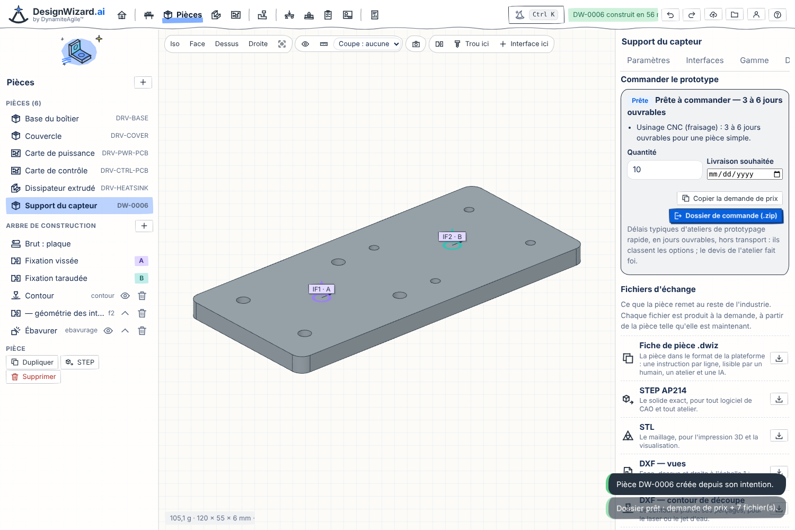
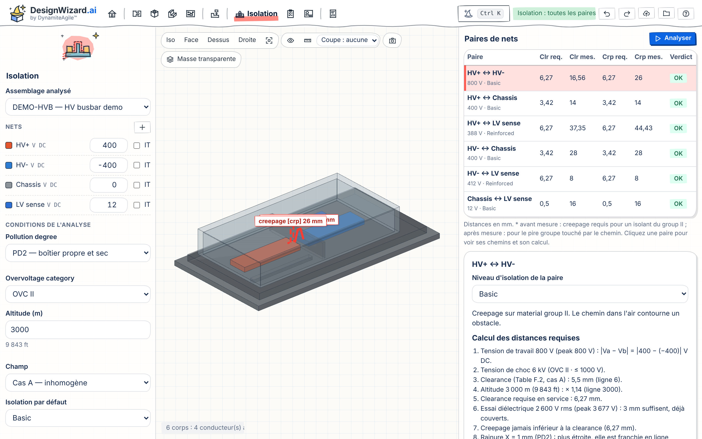

# DesignWizard.ai <sub>by DynamiteAgile™</sub>

**De l'intention à la pièce, de la pièce au système — la conception mécatronique réinventée, ouverte.**

L'objectif : **commander en quelques jours des pièces faisables, prototyper la physique d'un produit, l'essayer au
laboratoire** — et fermer la boucle de conception avant de lancer la production. Une pièce ne naît pas d'une esquisse
extrudée : elle naît de son **intention** — ses interfaces, sa matière, sa matière première — comme dans l'atelier
d'un artisan, aidé par l'IA. Les règles DFM, DFA, DFx et d'isolation s'appliquent dès la première minute.

Libre sous **licence MIT**. Tout tourne dans le navigateur ; vos fichiers restent chez vous.

> Cent trente-septième itération (v0.137.0 : **une pièce mince pliée, vue à plat** (demande de JP) — dans la barre de la vue, « Plié · À plat » déplie un flex ramifié, une bande flexible, un busbar ou une tôle pliée : le flan vu du dessus, chaque pli tracé en trait mixte avec sa note (UP / DOWN, angle, rayon intérieur), les sondes et les prises à leur place, la longueur développée sur la fibre neutre (k typique, dit à l'écran) ; « Plié » revient à la pièce montée ; le flex en boîte du CORE se lit à plat : une bande de 330 × 46 mm ; v0.136.0 : **BM 8s8p, cinquième itération : le support du bas et ses rondelles en une pièce** (choix de JP par menu ; la lecture du busbar laminé, une pièce par CORE, est confirmée) — le support du bas a un fond sous les cellules qui isole les godets de la plaque − et laisse monter les soudures par ses fenêtres ; ses 8 rondelles thermiques sont des corps de la même pièce, moulées en deuxième injection (2K), qui descendent par les trous de la plaque − jusqu'aux CTN du flex et centrent le busbar à la pose ; aucune erreur au bilan DFx ; rien ne traverse rien dans le CORE ; 104 pièces dans le module ; v0.135.0 : **BM 8s8p, quatrième itération, d'après les consignes de JP** — les deux L d'un CORE deviennent un seul **busbar laminé** : deux conducteurs, du papier aramide entre le cuivre et les cellules, un film mince dehors, une fenêtre et un bossage de soudure par calotte + (la plaque + ne repose plus sur le bord serti des cellules, au −) ; le **flex arrive à plat** et se replie **en boîte** : sa section centrale sous le CORE, deux panneaux pleine largeur aux petits bouts, le panneau X− qui continue dans la carte rigide posée sur le busbar ; **une CTN sous le centre de chaque cellule**, par le trou de la plaque − et sa rondelle thermique ; la brique du flex porte des capteurs sur son cœur ; rien ne traverse rien dans le CORE, 168 pièces dans le module ; un retour DFM sur le laminé plié, les soudures, le rigid-flex et l'union du support et des capteurs ; v0.134.0 : **BM 8s8p, troisième itération : le support de cellules** — une pièce moulée, deux par CORE, l'une en haut et l'autre en bas des cellules : comme les cellules d'une rangée se touchent presque (0,15 mm), le support les tient là où il y a de la place — une épine entre les deux rangées et ses dents, une barre à chaque petit bout qui laisse au flex son passage, une poche de 21,8 mm autour de chaque cellule (0,125 mm de jeu au rayon) ; le bilan DFx du premier jet a relevé une pointe de dent de 0,12 mm et des blocs de 11 mm : les dents sont raccourcies (pointe de 1,4 mm) et cinq noyautages laissent des parois de 1,5 mm — aucune erreur, un avertissement sur l'uniformité des parois ; le noyau 3D vérifie qu'il ne touche ni cellule, ni busbar, ni flex ; 128 pièces dans le module ; la dépouille et la tenue en vibration restent à faire ; v0.133.0 : **BM 8s8p, deuxième itération** — la cellule est la Molicel INR-21700-P45B, entrée dans la bibliothèque avec les valeurs de sa fiche lues page par page (45 A en décharge continue, 9 A en charge) ; le courant d'un CORE, 8 × 45 A = 360 A, dimensionne le cuivre : 2,0 mm, la seule épaisseur qui tient sous 60 °C (l'ambiante que la fiche admet en décharge) et sous 2,5 A/mm², calcul gardé dans le projet ; les busbars laissent aux petits bouts les jeux de 3 mm où plonge le **flex plié en G** — quatre doigts par bout, une CTN sous chaque cellule, B+ et B− —, vérifié par le noyau 3D : il ne traverse rien ; v0.132.0 : **le projet « BM 8s8p - 21700 »** — le module de batterie du projet, en première itération à reprendre ensemble : 8 CORE de 8 cellules 21700 en parallèle, en série côte à côte et tous dans le même sens ; chaque CORE avec sa carte de mesure sur le dessus (la carte de CORE du PCBA et son jumeau), un busbar + sur les bornes + et un busbar − sous les fonds, dont les jambes se pressent d'un CORE au suivant, et des isolants de flanc ; 104 pièces, 93 × 395 × 80 mm, 6,1 kg ; les épaisseurs sont des exemples, le flex, le boîtier et le BMS central restent à dessiner ; v0.131.0 : **des branches en parallèle, MAIN au centre** — dans l'Historique, chaque point a sa branche ; MAIN, la branche principale, est au milieu de l'arbre et nommée en tête, les autres s'ouvrent de chaque côté avec leur nom ; « Fusionner dans MAIN » reprend une branche d'un bloc après un aperçu (ce qui vient, ce que MAIN perd, ce qu'il garde), en une étape annulable ; rien n'est effacé — une pièce que MAIN a et que la branche n'a pas revient à Off, grisée, à activer pour la replacer ; et le fichier d'un coéquipier devient une branche, partie du point que les deux fichiers partagent, pour concevoir en équipe en parallèle ; v0.130.0 : **la carte de CORE** — l'exemple d'une petite carte posée sur le dessus d'un CORE de 8 cellules 21700 en parallèle, de sa taille : les 8 CTN sur les rabats d'un circuit flexible joint sous la carte, la tension du CORE, l'équilibrage passif sur ordre, RS-485 dont le côté bus est isolé et alimenté par le faisceau, deux borniers en chaîne vers le BMS central ; routée sur 4 couches sans plan, contrôles électrique et de layout sans erreur, chaque bloc essayé au Labo, la fiche matériel / logiciel qui suit les signaux à travers la barrière ; composants génériques, rien n'a tourné sur une vraie carte ; et **un noyau 3D calé se relance seul** — une pièce dont toutes les opérations échouent d'un coup est reconstruite par un noyau neuf, et toutes les pièces du commerce (chaque série sur toute sa plage de pôles, chaque cellule) sont construites par les essais ; v0.129.0 : **les deux documents du logiciel** — la spécification des exigences (chaque exigence, sa preuve, ses tuiles, la trace jusqu'aux fichiers C et aux essais) et le rapport de vérification (chaque essai rejoué sur le modèle, ses attendus, la matrice, la couverture du modèle, la liste de livraison), en Word et en PDF au gabarit des documents ; le paquet C en porte la même matière, doc/REQUIREMENTS.md et doc/VERIFICATION.md, et compile toujours dos à dos ; v0.128.0 : **le logiciel en cycle en V** — le Logiciel quitte l'Électronique pour un groupe à lui dans la barre du haut, sept écrans dans l'ordre du V : Exigences (une phrase avec « doit », relue par l'outil, allouée aux tuiles, tracée vers les essais dans les deux sens), Architecture (la référence de sécurité au choix du projet — DO-178C ou ISO 26262 et son niveau —, d'après des pages publiques lues, les normes elles-mêmes non lues), Conception, Simulation, Code, Vérification (des essais sur le modèle, la matrice de traçabilité, la couverture du modèle) et Livraison (ce qui doit tenir avant que le paquet parte) ; le V dessiné au-dessus de chaque écran ; une section par logiciel dans le rapport de revue ; aucune prétention de conformité ; v0.127.0 : **l'écosystème du produit, pour une IA** — un nouvel écran, Produit › Écosystème : la carte de ce qui dépend de quoi (un assemblage et ses pièces, deux pièces qui partagent une clé d'interface ou s'accouplent, une carte et son jumeau mécanique, un calcul ou un cas de charge et la pièce qu'il lit), ce qu'un changement dérange cerné d'ambre ; une entrevue (ce que je veux, ce qui ne doit pas bouger, comment je saurai que c'est réussi) ; le cadre de conception — les règles que l'outil vérifie, avec leur niveau de vérification, et celles du projet, On / Off — ; et un paquet .zip avec la consigne, que l'on porte à son assistant ; « Tout le contexte » dans la boîte IA de chaque écran y mène ; v0.126.0 : **l'historique de conception** — un nouvel écran, Produit › Historique : des points de restauration qui gardent tout le produit (pièces, assemblages, cartes, logiciel, revues, révisions), chaque artéfact rangé une seule fois ; revenir à un point en une étape annulable, comparer deux points, repartir — une branche s'ouvre, et l'arbre la dessine ; un point se pose aussi tout seul après chaque réponse d'IA appliquée, et s'emporte en .dwiz autonome ; v0.125.0 : **une barre de zoom sur chaque vue, et un panneau du bas qui se grandit** — les tuiles du logiciel se zooment à la molette, se déplacent en glissant le fond et s'ouvrent ajustées à la fenêtre ; une même barre en haut à droite des tuiles, d'une carte et d'un dessin : − et +, la taille réelle, « Ajuster » et la loupe, qui a quitté la barre du haut ; sous la simulation du Logiciel et sous les oscilloscopes du Labo, le panneau du bas se grandit par sa bordure et se replie, sa hauteur gardée pour chaque écran ; v0.124.0 : **le logiciel pas à pas** — sept étapes numérotées, dites pour quelqu'un qui apprend (CPU, objets, valeurs, démarrage, simulation, code, chargement) ; chaque tuile dit ses entrées et ses sorties ; le démarrage s'essaie et la mémoire se compte ; une simulation en direct où l'on tient le banc — une cellule qui monte, un contact soudé — en pause ou en marche, avec un chronogramme ; le code se lit à l'écran ; et les sept gestes du paquet au microcontrôleur, avec ce que son fabricant publie et la page où cela a été lu ; v0.123.0 : **des marges à glisser partout, et un accès lisible** — toute page qui a un volet de gauche ou de droite le laisse élargir et cacher : le PCBA n'avait aucune bordure, le Logiciel aucune à droite ; et l'administrateur de la démo voit ses comptes en clair — une ligne par compte, un nom qu'il lui donne (gardé dans son navigateur seulement), le rôle et ce qu'il permet, « Publié » ou « À publier », et ce qu'il reste à faire pas à pas ; v0.122.0 : **l'isolation d'une carte seule** — l'écran Isolation analyse un assemblage ou une carte (PCBA) : le menu « Ce que l'on analyse » offre les deux ; une carte s'analyse sur son cuivre réel — pastilles, pistes et vias de ses deux couches externes, stratifié nu, trous compris —, ses nets regroupés par tension, et chaque paire de potentiels nomme ses deux nets les plus proches ; ce qui n'est pas mesuré (couches internes, corps des composants) est dit à l'écran ; v0.121.0 : **le logiciel embarqué par objets reliés** — un nouvel écran, Électronique › Logiciel : le logiciel d'un BMS se dessine en tuiles reliées par des fils (mesurer, décider, commander), un fil est refusé quand les unités diffèrent, et l'outil en écrit le C — une bibliothèque, des modules, leur structure de fichiers — pour le CPU choisi, avec l'essai qui prouve, une fois compilé, qu'il imprime ce que le dessin donne ; premier CPU : un microcontrôleur de sécurité à deux cœurs en lockstep, sa fiche technique lue page par page ; v0.120.0 : **la variante en cours est vivante** — l'arbre et les paramètres d'une pièce disent de quelle variante ils sont, ce que l'on y met à On ou à Off et les valeurs que l'on change lui appartiennent sans bouton à presser, le « + » fait une copie qui devient la variante en cours, et le premier « + » garde la pièce d'avant sous « Origine » ; de même pour un assemblage ; v0.119.0 : **le Labo dit en clair, et le banc relève ce que l'écran trace** — chaque étape de « Manipulation en labo » dit en une ou deux phrases simples ce que l'on fait, les mots du banc se déplient, chaque point dit ce qu'est son signal ; « Écran et banc » montre comment ce que le Labo a tracé devient ce que l'on fait au vrai banc, et pourquoi les deux diffèrent ; un essai fait au multimètre relève maintenant la fin de chaque courbe de l'écran, un temps demande un oscilloscope et n'est plus dû, et la pince de masse d'un oscilloscope n'est plus jamais pointée sur un point vivant ; v0.118.0 : **geler, puis libérer** — « Libérer… » devient « Geler la révision » : le contenu est figé sous son numéro, avec le nom de son auteur ; une revue de conception courte — ce que l'outil vérifie lui-même sur le contenu gelé, puis ce que l'approbateur confirme — la libère ou la refuse, l'approbateur étant quelqu'un d'autre que l'auteur ; chaque ligne de l'écran Révisions porte le nom de la révision et son état (en travail, gelée, libérée, refusée), et la fiche de revue sort en PDF ; v0.117.0 : **la manipulation sur papier** — la procédure d'un essai du Labo sort en PDF avec une image de la carte à chaque étape qui la touche (l'anneau sur la pastille, la lettre du cordon, la broche), une case par relevé et des lignes de notes ; remplie de ce que le carnet de la carte garde — coches, relevés, passages par un superviseur, notes —, c'est le compte rendu de l'essai ; pour un essai, ou pour tout le plan ; v0.116.0 : **la liaison RS-485, de la pièce au code** — le bloc de carte complet (transceiver, rappel sur DE, écrêteur et résistances série au bornier, terminaison, polarisation du bus au repos calculée par la formule de deux notes d'application lues), ses essais du Labo (niveaux, bus au repos, une vraie trame), une carte d'exemple routée, la fiche d'**interface matériel / logiciel** lue des nets de la carte (Word, PDF) et le **pilote C** que l'outil écrit à partir du même modèle — compilé, il redonne les trames imprimées par la spécification MODBUS ; et le **vocabulaire des systèmes de batteries** ramené aux termes que les normes et les autorités publient, chaque terme avec le document qui le porte ; v0.115.0 : **Manipulation en labo** — un essai du plan de test se fait au vrai banc, une étape par écran, en plein écran : chaque branchement est pointé sur la carte (un anneau sur la pastille, le cordon qui y va), l'appareil est dessiné avec son réglage, une étape s'ouvre quand celles d'avant sont faites, la recherche d'un court-circuit précède la mise sous tension, un relevé hors plage arrête l'essai et un superviseur peut laisser passer par son nom ; relevés, coches et notes restent dans le carnet de la carte, et tout se calcule sans IA ; v0.114.0 : **ce qui est nouveau est marqué à l'écran** — chaque version dit ce qu'elle change, sur quel écran et sur quel élément ; l'élément porte une marque « Nouveau », le bouton à l'étoile de la barre du haut en tient la liste, « Montrer » y mène ; cocher « vu » garde la marque, en vert — c'est la trace de la revue — et seul « Passer à une nouvelle revue » range les marques, la revue rangée se rouvrant du même endroit ; v0.113.0 : **de l'Analytique à la Simulation, avec la même géométrie** — sous le schéma d'un modèle analytique, « Simuler cette géométrie » ouvre la Simulation sur un modèle simplifié fait du calcul lui-même : ses dimensions, sa matière, ses appuis et sa charge, prêt à lancer ; le recoupement dit alors si les deux calculs s'accordent ; ce n'est pas une pièce du produit — l'Atelier le range en dernier, sous « Simplified models » —, il se met à jour quand on simule de nouveau, et sa marche vers le haut ramène au modèle analytique avec ses valeurs ; un modèle que la simulation ne sait pas reprendre tel quel dit pourquoi ; v0.112.0 : **la carte et son PCBA, attachés** — on descend d'un niveau comme on monte : à côté de la marche vers le haut, en tête du volet de gauche, les pictogrammes de ce qui est fait à partir de ce que l'écran montre — la carte mène à son PCBA, le PCBA à son Labo, une pièce à son dessin et à sa simulation, un assemblage à ses sous-assemblages — et Alt + ↓ répond à Alt + ↑ ; le jumeau mécanique d'une carte naît à son premier composant placé et la suit dans l'étape même qui la change ; les noms du métier se choisissent — PCB · PCBA, PWB · CCA, PWB · PWA, ou les mots de la maison — et tout l'écran comme les documents Word et PDF suivent, sans toucher aux identifiants ; v0.111.0 : **les calculs rejoués contre des exemples publiés** — chaque modèle analytique, et le solveur de la simulation, rejoue des exemples chiffrés que d'autres ont publiés (manuels libres, pages d'ingénierie, notes de cours) : la source et son lien, ce qu'elle imprime, ce que l'outil trouve, l'écart et la tolérance, dans l'onglet « Calcul », dans la Simulation et dans l'Aide ; la valeur attendue n'est jamais calculée ici, un modèle sans exemple le dit — 18 modèles sur 24 en ont un —, et chaque modèle dit ce que ses cas ne couvrent pas ; v0.110.0 : **l'IA depuis chaque écran, et un seul journal** — un bouton « IA » en tête du volet de gauche de tous les studios confie à un assistant ce que l'écran montre — la pièce, l'assemblage, la carte — ; toute réponse appliquée, d'où qu'elle vienne, entre au même journal dans l'étape qui l'applique, et « Revenir à avant » la défait même après d'autres changements ; v0.109.0 : **créer avec l'IA, et voir ce qui entrera** — la troisième porte de l'Atelier : une phrase, et l'outil écrit la consigne (une pièce, plusieurs, un assemblage complet ; les interfaces libres du projet ; « pose-moi tes questions d'abord »), à copier ou à emporter en dossier .zip ; la réponse revient en .dwiz, en .json, en .zip ou collée, et l'aperçu dit ce qui serait créé, modifié ou écarté — et où chaque chose se range — avant que rien n'entre ; « Appliquer » est une seule étape annulable, et le journal revient à avant une réponse même plus tard ; l'outil n'appelle aucune IA ; v0.108.0 : **une nouvelle pièce, une question à la fois** — la page de l'intention ne montre plus tout d'un coup : six questions (son rôle, ses contraintes, ses voisines, ses interfaces, sa matière, la pièce proposée), un rail qui dit où l'on est, « Retour », « Passer », « Suivant » ou Entrée ; la pièce naît à droite à mesure des réponses, et la fiche « Ce qui est retenu » ramène à une réponse d'un clic ; les champs sont les mêmes, et « Tout voir sur une page » les remet ensemble ; v0.107.0 : **plusieurs à la fois, et des dossiers** — un réglage touché sur une ligne choisie vaut pour toute la sélection : la pastille de couleur, l'interrupteur On / Off, l'œil et le clic droit d'une pièce d'assemblage choisie avec d'autres agissent sur toutes, en une étape annulable, et le volet de droite montre la fiche du lot ; les opérations d'une pièce se choisissent à plusieurs dans son arbre (Off, dupliquer, supprimer) ; un dossier range des opérations ou des éléments d'assemblage sous une ligne qui se replie — replié pour la vue d'ensemble, déplié pour le détail — sans rien changer à la pièce ni à l'assemblage ; v0.106.0 : **les niveaux de l'Atelier, et une marche d'escalier partout** — l'Atelier devient le plancher d'où l'on voit toutes les pièces du produit, par nature ou par assemblage, avec trois portes pour en créer ; un fil d'Ariane numéroté (1 l'Atelier, 2 une nature de pièce, 3 une pièce) remplace la rangée de sous-onglets, sur tous ses écrans — Busbars et circuits flexibles compris : un clic sur un niveau y remonte, son chevron liste les sœurs puis les autres pièces ; sur chaque écran, un pictogramme en tête du volet de gauche mène à ce dont l'écran dépend (du Labo à la carte, d'une simulation ou d'un dessin à la pièce, de l'Isolation à l'assemblage), Alt + ↑ aussi ; des onglets de travail gardent plusieurs pièces sous la main ; v0.105.0 : **le quotidien** — la pièce affichée se choisit dans un menu déroulant avec recherche, groupé par procédé, et l'arbre de construction vient juste dessous ; Ctrl + clic choisit plusieurs pièces ou plusieurs éléments d'un assemblage, Maj + clic toute une suite, pour changer leur apparence ou leur matériau ensemble, les grouper, les mettre à Off ; la palette d'apparence s'ouvre dans la marge de droite et y reste jusqu'à ce qu'on la ferme ; la page des connecteurs de la Bibliothèque est rangée — plus rien ne sort d'une carte ni de la page — et la barre du haut tient dans une fenêtre de 1100 px ; v0.104.1 : **des instruments dans la Simulation, et la vue infrarouge** — un capteur de température (TC) sur un calcul thermique, une jauge de déformation (SG, ou une rosette) sur un calcul de structure : posés d'un clic droit sur le modèle ou sur le résultat, lus à l'écran sur le résultat gardé — déplacer un capteur ou tourner une jauge change sa lecture sans relancer ; un résultat thermique se regarde aussi comme une image de caméra thermique, « IR · Iron » ou « IR · White hot », point chaud et point froid marqués ([docs/SIMULATION.md](docs/SIMULATION.md), § 5 bis) ; v0.103.0 : **le Labo simule la carte entière** — les blocs reliés par les nets de la carte, une alimentation de laboratoire à l'entrée, chaque rail né du précédent : la mise sous tension de toute la carte, puis à quelle tension d'entrée chaque rail s'établit et lâche ; le plan de test se termine sur ces deux essais d'ensemble, avec leurs valeurs attendues ; v0.102.2 : **l'essai pilote d'une heure** — onze stations sur la démonstration, sa fiche de retour, et un robot qui vérifie que chaque mot cité par une étape est bien à l'écran ([docs/ESSAI_PILOTE.md](docs/ESSAI_PILOTE.md)) ; v0.102.1 : **le Labo, laboratoire d'électronique virtuel** — après le PCBA, chaque bloc de la carte sur un banc simulé : les pistes et les composants s'allument avec le courant, deux oscilloscopes montrent ce que l'on injecte et ce qui sort, une DEL ou une mémoire dit son changement d'état ; et le **plan de test fonctionnel** de la carte sort en Word ou en PDF, une fiche par essai — comprendre, puis faire — pour quelqu'un qui apprend le métier ; la barre du haut se range en **trois groupes par discipline** : Mécanique, Électronique, Produit ; v0.101.0 : **le studio photo** — dans l'Assemblage, « Photo » : le produit dans un décor construit autour de lui (studio, désert, campagne, neige, bord de mer, bateau, porte-avions, rue, toit — tous fabriqués par l'outil), sous des lumières que l'on place sur un plan vu de dessus ou dans la vue, avec des ombres portées sur le vrai sol et une image qui s'affine dès que rien ne bouge ; v0.100.0 : **l'apparence des pièces : couleur, finition et camouflage** — six motifs de camouflage fabriqués par l'outil (Forest, Jungle, Desert, Snow, Urban, Navy), quatre finitions à l'écran, et une apparence que l'assemblage peut donner à une pièce, à un sous-assemblage ou à lui-même tout entier — elle l'emporte sur celle de la pièce ; v0.99.0 : **le film sur les écrans d'aujourd'hui** — toutes les captures et les trois plans filmés refaits, deux moments de plus dans l'histoire : la famille de variantes d'une pièce et le produit monté par modules ; 2 min 50, les répliques déjà enregistrées gardées ; la bande-annonce se recoupe du nouveau film ; v0.98.0 : **plusieurs cas de charge nommés par pièce** dans la Simulation — un cas en cours, vivant, les autres gardés tels qu'on les a laissés ; un nouveau cas est une copie du cas en cours, un clic passe de l'un à l'autre, chaque essai dit de quel cas il vient ; v0.97.0 : **ce qui sort suit une variante** — un fichier, une gamme, une commande ou un envoi dit de quelle variante il vient, dans son nom et son en-tête, et se fait pour une variante choisie d'après une copie, par le menu « Variante qui sort », sans changer la pièce ni l'assemblage ; le rapport liste les variantes de chaque document ; v0.96.0 : **tourner une pièce de l'assemblage par une poignée dans la vue** — un anneau autour de la pièce choisie, autour de Z si elle est posée à la main, autour de la normale de son accouplement sinon ; crans de 5°, ce qui tient à elle suit en direct, une étape annulable, le même angle en nombre dans sa fiche ; v0.95.0 : **tourner une vue dans le plan de l'écran, directement** — un glisser depuis le bord de la vue (la bande s'allume), deux flèches sous le repère X Y Z, Alt + ← / → ; **rotation libre d'office**, table tournante au choix ; les touches fléchées tournent la vue de 15° (Ctrl : 5°, Maj : 90°) ; v0.94.0 : **former un sous-assemblage à partir de pièces déjà posées, et le dissoudre** — un dialogue qui dit avant de faire ce qui passera à l'intérieur, rien ne bouge, une étape annulable ; la vue éclatée ouvre les blocs ; le **Rover de la démonstration est par modules** (châssis roulant, plateau électronique) ; v0.93.0 : **ce qui sort d'un assemblage garde ses niveaux** — le dessin d'ensemble liste son niveau (un sous-assemblage = une ligne et une bulle, « à plat » au choix), le STEP écrit chaque sous-assemblage comme un produit du fichier, et une libération gèle la révision de chaque sous-assemblage dans son parent ; v0.92.0 : **le film raconte une histoire** — la voix, en français ou en anglais, ne lit plus ce qui est écrit à l'écran : elle suit une pièce de sa question (« à quoi doit-elle servir ? ») jusqu'à la commande, et les **sous-titres restent avec la voix**, dans la langue du film, dans l'autre, dans les deux ou aucun ; storyline dans `docs/film/storyline.md` ; v0.91.1 : la **présentation guidée** à jour — deux pages de plus (un produit par modules et en plusieurs versions ; comparer des cas de charge), la page de la pièce montre la rotation automatique, dix-neuf captures refaites ; v0.91.0 : **sous-assemblages** — un assemblage entre dans un autre comme une seule ligne, monté dans son propre document et porté d'un seul bloc : il s'accouple seul par les interfaces que ses pièces laissent libres, un accouplement suffit à le porter, et il ne peut pas se contenir lui-même ; la nomenclature se lit par niveaux ou à plat ; la vue, la masse, la gamme (une étape pour le bloc), le DFA, les dessins, l'isolation, la simulation, le guide, la revue et les exports comptent chaque pièce à travers les niveaux ; v0.90.0 : **ce que l'on règle se retrouve** — le cas de charge de la Simulation est gardé dans le projet, par pièce ou assemblage : chaque changement est une étape annulable, et le cas revient après un rechargement ou chez un coéquipier ; un assemblage garde ses **variantes** sous un nom (les pièces à On et à Off) et y revient d'un clic ; **chaque variante a son dessin**, d'une pièce ou d'un assemblage, sans changer le document — le cartouche dit laquelle ; v0.89.0 : **la rotation automatique combine ses sens** — dans le panneau, chaque axe a son interrupteur (◀ ▶ autour du Z, ▲ ▼ la bascule, ↺ ↻ le roulis) : deux ou trois flèches restent allumées ensemble, la pièce tourne sur son Z pendant que l'œil passe par-dessus, et chaque axe qui tourne a sa flèche qui fait le tour de son anneau dans le repère ; v0.88.1 : la rotation d'une vue n'a plus de butée — vue de dessus, gauche / droite fait pivoter l'image dans son plan ; l'inclinaison passe par-dessus ; Alt + glisser roule la vue ; v0.88.0 : **tourner une vue, en sachant comment** — une vue 3D tourne autour du point saisi, la pièce suit la main, et un repère montre le pivot, l'axe, l'arc parcouru et les angles ; un appui tenu deux secondes lance une rotation automatique, sens et vitesse choisis à l'écran ; dans l'assemblage, un clic droit sur une pièce de la liste ouvre son menu — la montrer seule, tout afficher, On / Off, fixer, ouvrir, retirer ; v0.87.0 : **variantes nommées et plans à On / Off** — une pièce garde ses cousines sous un nom (opérations à On ou à Off, valeurs des paramètres) et y revient d'un clic, en une étape annulable ; dans la Simulation, chaque plan de coupe ou de symétrie a son interrupteur et sa copie — un plan à Off ne coupe rien, un seul plan par axe compte, un essai nomme ses coupes ; v0.86.1 : une page restée ouverte **annonce la nouvelle version** publiée et offre de se mettre à jour — projet enregistré, fichiers redemandés, page rechargée ; v0.86.0 : **On / Off et copies** — plusieurs cas dans un seul modèle : dans la Simulation, chaque appui, effort, source, température et zone se met à Off (gardé, hors du calcul) ou se duplique (la copie naît à Off), chaque essai retient le cas calculé et les essais se comparent côte à côte ; dans l'assemblage, une pièce à Off sort de la vue, de la nomenclature, de la masse, des accouplements, des dessins et des exports, et revient telle quelle ; dans la CAO, chaque opération a son interrupteur et sa copie, et un paramètre garde d'autres valeurs à côté de celle qui compte — une famille de pièces dans une seule pièce ; v0.85.0 : **zoom et loupe** — une feuille de dessin se zoome au centre de la page (Ctrl + molette autour du pointeur, boutons − et +, 50 % à 800 %, glisser pour se déplacer) ; une **loupe** dans la barre du haut : une lentille suit le pointeur sur les dessins, les cartes, les schémas et les vues 3D, grossissement réglable par un court curseur (× 1,5 à × 8), le pointeur agit au travers ; v0.84.0 : **volets qui se rangent** — un clic sur le titre d'un groupe le replie (chevron à droite) et fait remonter les suivants, dans tous les studios ; Alt + clic n'en garde qu'un ouvert, un bouton replie tout ; un volet redessiné **reste où il était**, le curseur dans son champ, au lieu de remonter en haut après chaque valeur ; dans la Simulation, « Lancer la simulation » et la bascule modèle / résultat sont épinglés en tête du volet de droite, le résultat passe devant l'estimation à la main, et un œil range les volumes des zones de raffinement — rangés d'office sur le résultat ; v0.83.0 : **appuis et efforts sur toute la géométrie** — la Simulation montre la pièce elle-même : un clic droit sur n'importe quelle face (plane, alésage, inclinée, intérieure), arête ou point y pose un appui, un effort ou une source ; Ctrl + clic en réunit plusieurs ; la face d'une coupe se pointe aussi ; un effort prend une direction quelconque, un appui ne bloque que les directions cochées ; une zone de raffinement se règle d'office sur une seule paroi) ; quatre-vingt-deuxième (v0.82.0 : **zones de raffinement dans la Simulation** — un cylindre ou un prisme à section carrée, le long de X, Y ou Z, posé dans le modèle par un clic droit ; là où il coupe la pièce les cubes sont 2, 3 ou 4 fois plus petits, sa forme se voit sur la pièce, et la zone est résolue avec le reste comme un seul maillage — la pointe y égale celle d'un maillage fin partout à moins de 3 % près) ; quatre-vingt-unième (v0.81.0 : **le film parle** — une voix de synthèse, en français et en anglais, sur la vitrine et à l'accueil ; aucun sous-titre tant que le son joue : ils apparaissent quand on coche « Sans son » sous le film, ou que le lecteur est muet) ; quatre-vingtième (v0.80.1 : **le film est prêt à parler** — avec la voix, plus de sous-titres dans l'image : ils n'apparaissent que si le son du lecteur est coupé ; le site reste muet tant que la voix n'est pas publiable ; v0.80.0 : **les exports longs se voient et s'annulent** — STEP d'un assemblage, dossier de commande et fichiers d'une pièce, préparation et envoi vers Onshape : le même voile, la progression fichier par fichier, et un bouton Annuler ; un envoi Onshape arrêté dit ce qui est déjà là-bas et s'offre à reprendre) ; soixante-dix-neuvième (v0.79.0 : **la vidéo de présentation** — deux minutes trente-trois sur les vrais écrans de l'outil, en français et en anglais, sur la vitrine et à l'accueil (« Voir la vidéo ») ; sans son pour l'instant, la narration se lit à l'écran ; une seule ligne de temps pour l'image, les sous-titres et le texte à enregistrer — `docs/VIDEO.md`) ; soixante-dix-huitième (v0.78.1 : le même voile sur le bilan DFx de tout le projet, le dossier de revue et le chargement d'un projet ; v0.78.0 : **une opération longue se voit et s'annule** — un voile dit ce qui se fait, avec une ligne de progression, les octets du noyau pendant qu'il arrive, le temps écoulé et un bouton Annuler, puis Reprendre ; la barre du haut ne dit plus « Prêt » pendant que le noyau se télécharge) ; soixante-dix-septième (v0.77.0 : **le guide sur les écrans restants** — Isolation, Dessins et Commande disent au bouton « Guide » ce qui manque : tensions, analyse, paires en défaut ; cartouche et statut ; ce qui bloque ou ralentit une commande, quantité à confirmer) ; soixante-seizième (v0.76.0 : **les flèches à vitesse progressive** — dans tout champ numérique, une flèche ajoute ou retire 1 ; maintenue ou cliquée vite, elle accélère, ×2, ×5, ×10, avec un témoin de vitesse à côté du champ) ; soixante-quinzième (v0.75.1 : présentation — une page « La conception dans vos unités, les calculs en SI », toutes les captures refaites ; v0.75.0 : **le guide sur la carte** — le bouton « Guide » dit ce qu'une carte électronique demande encore, depuis n'importe quel écran, et un clic mène à l'étape où cela se règle) ; soixante-quatorzième (v0.74.0 : **les calculs restent en SI** — modèles analytiques, simulation et isolation ne suivent plus le choix d'unités, qui devient celui de la conception ; le choix d'unité de pression disparaît) ; soixante-treizième (v0.73.1 : présentation à jour et classeur de relecture de l'anglais des démonstrations, `tools/words_review.mjs` ; v0.73.0 : **la carte en mil** — avec le système impérial, l'écran de la carte électronique se lit et se tape en mil et en pouces, cuivre en onces, constats, règles, gamme et rapport de revue compris ; les fichiers de fabrication restent en millimètres) ; soixante-douzième (v0.72.0 : **les unités, le reste** — champs du busbar, du circuit flexible, des étiquettes et de la simulation (efforts, pressions, échelle des couleurs), distances d'isolation, position d'une occurrence, dossier de revue et gammes enregistrés dans l'unité choisie) ; soixante et onzième (v0.71.0 : **l'anglais du dessin** — le projet donne une fois l'anglais de ses propres textes (noms, interfaces, paramètres, notes), à la main ou par un aller-retour avec une IA ; les démonstrations arrivent avec le leur, leurs dessins sont en anglais d'un bout à l'autre) ; soixante-dixième (v0.70.2 : le **verdict du classeur Excel lit le domaine de validité**, comme l'écran ; v0.70.1 : la **présentation guidée à jour** — une page « Le calcul à emporter », les unités, les dessins en anglais, les premiers pas, toutes les captures refaites ; v0.70.0 : **les unités partout** — SI ou impérial dans les paramètres des pièces (lus et tapés), les mesures des vues 3D, l'Atelier, l'assemblage, DFx, le guide, les gammes et les dessins, cotés en pouces à la façon d'ASME Y14.5 ; le projet reste en millimètres) ; soixante-neuvième (v0.69.0 : **le classeur Excel vivant pour les 21 modèles de calcul** — résultats, marges et verdicts en formules, vérifications qui se réveillent quand leur case jaune est remplie, feuille « Solveur » pour les bilans résolus pas à pas ; recalculé par les tests et une fois par LibreOffice, égal à la plateforme) ; soixante-huitième (v0.68.0 : **les dessins en anglais partout** — noms des vues, cartouche, REVISIONS, NOTES, BILL OF MATERIALS, tableaux, libellés des cotes et notes du DXF du développé, avec le point décimal ; ce que le projet a tapé reste tel quel) ; soixante-septième (v0.67.0 : **premiers pas guidés** — huit étapes, de la page blanche à la révision libérée, qui se cochent d'après le projet ; le guide de chaque écran rappelle l'étape en cours) ; soixante-sixième (v0.66.0 : **les longues listes deviennent des arbres** — corps et paires de nets de l'Isolation, cotes des Dessins, constats de la carte — par état ou par nature, un seul éditeur ouvert à la fois) ; soixante-cinquième (v0.65.0 : **les termes techniques en anglais, partout où il en restait** — titres des 221 règles DFx / DFA / carte, des 21 modèles de calcul, noms et familles de matières ; glossaire de 398 termes) ; soixante-quatrième (v0.64.1 : **chaque série de connecteurs a son modèle**, reconstruit d'après les cotes publiées — 50 séries LV et HV, leur couleur, leur face d'accouplement — et **son empreinte de carte**, avec le niveau de lecture de ses cotes : 15 séries lues sur la fiche, 6 en partie, 29 à vérifier) ; soixante-troisième (v0.63.0 : un calcul analytique **part en note de calcul Word et PDF, au gabarit des autres documents**, et en **classeur Excel pour itérer hors ligne** — cases jaunes, médias en liste, vérifications et verdict, un balayage et une courbe par donnée ; six modèles y sont vivants, leurs résultats en formules ; v0.62.0 : dans les modèles analytiques, **un média, pas une valeur** — le matériau ou le fluide se choisit dans un menu (solides, puis liquides, puis gaz, par groupe et par nom) et ses propriétés en découlent, en lecture seule ; une **base des médias** consultable, 42 solides, 5 liquides et 4 gaz, chacun avec ses propriétés et leur source ; v0.61.0 : **tous les termes techniques en anglais**, comme le métier les nomme — opérations, formes, interfaces, matières premières, colles, soudages, revêtements, contacts, impression 3D, finitions, genres de joint —, avec un **glossaire anglais ↔ français** de 184 termes dans l'Aide ; v0.60.0 : **la pièce moulée pensée par son mold** — un onglet « Mold » qui fait choisir le gate, trace le parting line et le pull, compte les slides, place les risers d'une pièce coulée et dit ce que tout cela laisse sur la pièce une fois scié et poncé ; deux procédés de plus, **low pressure die casting** (rempli par le bas, jusqu'aux risers) et **permanent mold casting** ; les **procédés nommés en anglais** partout, comme le métier les nomme ; v0.59.0 : le **choix d'unités** — SI, ou un impérial hybride d'ingénierie (pouce, livre-force, psi, ksi ; le mètre, le m/s et le kg restent, une masse se lit « kg (lb) ») — et une **pression qui se lit en kPa, bar, psi ou atm**, avec ses équivalents sous le chiffre : les modèles analytiques suivent en entier, le projet reste en SI ; v0.58.0 : dans l'Assemblage, **un clic sur un mate montre ce qu'il est**, quel que soit le type d'interface — les deux pièces en transparence, chaque vis avec sa tête, son insert ou son écrou, chaque goupille à sa profondeur, le contour de l'appui, du collage, de l'ouverture ; et dans sa fiche une coupe schématique et le tableau de ce qui définit le joint, côté A et côté B ; v0.57.2 : la **Simulation** s'ouvre sur une pièce à goupilles (elle restait vide, sans le dire) et dit maintenant ce qui arrête son premier maillage ; un outil qui écrit une **storyline animée** depuis de vraies captures (`tools/storyline.mjs`) ; v0.57.1 : un bouton **GitHub** à l'accueil, sur la page d'accès et sur la vitrine ; v0.57.0 : le **rendu marketing** — la **finition de chaque pièce** (peintures, métaux, plastiques, composites, transparents, avec leurs motifs), un décor, un point de vue, l'ombre au sol, les étiquettes, et l'image en **PNG** avec la marque ; v0.56.0 : les **étiquettes** — autocollants, plaques signalétiques et marquages, à leur taille, posés à la souris sur une **face plane** ou **enroulés sans étirement sur un cylindre** ; motif en SVG à l'échelle pour l'imprimeur ; la fusée porte l'autocollant DesignWizard.ai ; v0.55.0 : un quatrième exemple, une **fusée à moteur hybride** de 8 po et 3,66 m — tuyère refroidie par un **serpentin en hélice**, bloc de polyuréthane, réservoir de protoxyde d'azote, vanne, carte de commande, parachute, quatre ailerons fixes : un exercice de CAO, ni dimensionné ni validé ; le langage de pièce gagne l'opération **`coil`** (tube en hélice sur un cylindre ou un cône) ; v0.54.0 : un troisième exemple, le **Rover** de la visite guidée de DynamiteAgile, en 3D — vingt-quatre pièces aux références de sa nomenclature, trente instances, toutes accouplées par leurs interfaces ; v0.53.0 : le **circuit flexible ramifié** — un **cœur large** sous (ou sur) une **carte rigide**, des **branches de largeurs différentes** qui partent vers X ou Y et se **plient vers Z+ ou Z−**, avec au bout une sonde de température, une prise de tension, une **languette clipsée** dans une fente ou des plages à braser ; un **exemple à sept branches** ; v0.52.0 : la **bibliothèque électrique** montre ses composants en **3D** — une carte par famille, groupée par genre, avec l'**aperçu** de sa forme ; un connecteur ajouté au projet prend la **forme de son genre** (embase à picots, circulaire, haute tension à ports ronds, bornier…) au lieu d'une boîte, et le **modèle STEP du fabricant** se met à sa place depuis la fiche de la pièce ; v0.51.0 : **poser à la souris, aidé** — un outil armé montre sur la face une **grille de 5 mm**, la **ligne de centre** quand l'axe de symétrie accroche, les **cotes** et une **fenêtre de coordonnées** en direct ; un clic pose, deux secondes de maintien reprennent ; les busbars reçoivent leurs **trous de passage** (ronds ou oblongs) ; la mesure s'accroche en **parallèle** à un axe ; chaque accrochage se règle au clic droit ; v0.50.0 : le **contact à pression** prend **trois formes**, choisies sur leur coupe — **bossages coniques** emboutis dans la barre (série de l'ISO 8167, et en option soudés par bossage), **lames à ressort** cambrées dans une barre mince, **bande de lamelles** rapportée — avec ce que la plateforme conseille selon le **courant**, la **tension** (classes de l'ISO 6469-3) et l'épaisseur de la barre ; v0.49.0 : chaque **pièce** reçoit la **couleur** et la **teinte** que son concepteur lui donne — une pastille à côté de chaque pièce, un sélecteur par couleurs et par teintes, plus clair / plus foncé, opaque ou transparent, « une couleur par pièce » d'un clic ; la couleur suit la pièce dans l'assemblage sans toucher ni à la revue ni à la révision ; v0.48.0 : l'**aide** tient le **registre des sources** — chaque méthode, convention ou norme d'un outil (IEC 60664-1, ASME Y14.5, IPC-2221B, manuels de calcul, guides de procédés…) sur une ligne fermée qui s'ouvre au clic sur ce qu'elle couvre, ce que l'outil en prend et son **niveau de vérification vrai**, de « lu » à « non lu » ; v0.47.0 : les **niveaux de maturité (TRL)** portent leur **définition officielle** — NASA et Commission européenne, citées telles que lues, traduction à côté — avec, pour chaque niveau cliqué, ce qu'il faut montrer, **deux exemples** (automobile, aéronautique) et les **références** en bas de page, lues ou non lues ; v0.46.0 : « Vérifier l'échauffement » d'un **busbar** ouvre le calcul **déjà rempli** — bande, longueur le long de la fibre, courant, finition, matière ; chaque **calcul analytique** se garde sous un **nom**, au nom de sa pièce, plusieurs par pièce au fil du temps, rangés par pièce et, dans Drive, en fiche texte sous `03_Analyses` ; v0.45.0 : les **dessins** donnent la feuille aux vues — plus grande échelle qui tient (la base du boîtier passe du 1:2,5 au 1:1,5), notes dans une bande en bas à côté du cartouche, tableaux regroupés dans le coin que trois vues laissent vide, cotes de définition sur une **feuille 2** ; chaque **tolérance géométrique** est reliée à ce qu'elle contrôle par un **drapeau hexagonal** (T1, T2…) fléché sur l'élément et repris au tableau avec les repères de ses trous ; v0.44.0 : les **documents à lire** prennent un vrai gabarit d'ingénierie — cartouche d'en-tête encadré sur chaque page (marque, titre, n° de document, révision, date, page n de N), page de titre avec **approbation** et **journal des révisions**, **note de confidentialité** du projet et note de la plateforme au pied de chaque page ; le **dossier de revue de conception** sort en **PDF** et en **Word** à ce gabarit, lu sur ce que l'écran montre ; l'organisation et la note de confidentialité se règlent dans le cartouche des Dessins et servent à tous les livrables ; v0.43.0 : chaque **vue 3D** porte son **repère X Y Z** en haut à droite (un clic sur une lettre regarde le long de l'axe) et peut montrer une **grille derrière la pièce**, au pas rond en millimètres (bouton « Grille », touche G) ; les préférences règlent la **taille de l'affichage** en cinq pas, de 90 à 150 % — textes, boutons, étiquettes et volets suivent ; v0.42.0 : **tous les documents** portent la marque — le symbole et « DesignWizard.ai™ by DynamiteAgile™ » en tête des PDF, des documents Word, des dessins et de la revue, et au pied de chacun la note « Co-Intelligence WorkFlow™ — document généré par DesignWizard.ai. La version électronique fait foi ; la version imprimée est pour référence. » ; les fichiers texte et de fabrication (CSV, `.dwiz`, DXF, STEP, STL, Gerber, perçage, FeatureScript, JSON), ce qui s'écrit dans Drive et ce qui part vers Onshape la portent comme un commentaire de leur format ; v0.41.0 : le **joint collé** porte un **logement de colle** — une poche de la profondeur du film, entourée d'une lèvre d'appui de 3 mm et plus sur laquelle l'autre pièce repose sans écraser la colle — et il **suit la face** : sur une coque moulée, la plage monte sur un massif évidé adossé à la paroi, jusqu'au plan de joint ; dans l'**Atelier**, ce que le compagnon ajoute de lui-même (fermeture du couvercle, plan de joint) se voit **parmi les interfaces**, à garder ou à retirer ; les **menus de matières** sont classés par nom (Aluminium, Inox, Acier…), chaque matière avec ses procédés entre parenthèses ; v0.40.0 : la page **DFx** s'ouvre sur les **points à régler** — les compteurs du haut sont des boutons (à régler, à corriger, à vérifier, conseils, conformes) qui mènent droit à chaque point, avec ce qui a été mesuré, le pourquoi de la règle et son **correctif en un clic**, essayé avant d'être appliqué (un correctif qui créerait un point à corriger est retenu et dit pourquoi) ; ce qui est conforme est rangé à part ; dans l'**Atelier**, les matières se choisissent par nature, une pastille de couleur chacune, et une matière première choisie à la main **grise les matières que son procédé ne travaille pas** ; v0.39.0 : les **modèles analytiques** prennent la structure des autres studios — les entrées à gauche, le modèle au centre en **2D** (schéma) et en **3D** aux dimensions tapées, le choix du modèle à droite en **tuiles rangées par physique**, une couleur et un pictogramme par physique ; une valeur d'exemple est marquée, la prochaine à entrer clignote et le rapport attend ; dans la **Simulation**, un **plan de symétrie** devient une frontière bloquée S1 — une seule symétrie à la fois, et la retirer passe par un avertissement qui explique la dépendance ; v0.38.0 : dans l'**Assemblage**, les accouplements se lisent en **arbre par état** — rompus, à vérifier, sains — avec leur couleur, un œil par état pour leurs étiquettes sur le modèle, et un clic qui allume les deux pièces ; v0.37.2 : l'**essai à deux** se répète sur un poste, sans Google (deux scénarios, par fichier et par Drive simulé), et le guide signale partout un conflit d'équipe à trancher ou un message en attente ; v0.37.1 : **audit d'ergonomie** de tous les écrans à trois tailles de fenêtre — les noms longs prennent une seconde ligne au lieu d'être coupés, les pastilles de la vue se lisent en entier, les petits boutons grossissent ; v0.37.0 : un **guide** sur tous les écrans — le bouton « Guide » de la barre du haut dit ce qui manque ou cloche, ici et dans le projet (pièce sans matière, paramètre hors bornes, interface que personne ne reprend, assemblage qui flotte…), un clic mène à l'endroit ; l'**Atelier** signale en direct une pièce sans nom ou une matière qui ne va pas avec la matière première, et le champ qui attend clignote ; v0.36.0 : dans la **Simulation**, un bouton va et vient entre le **modèle** (conditions et étiquettes) et le **résultat**, qui n'est plus perdu quand on retouche le cas — chaque calcul est un essai numéroté, pour converger ; le **facteur de sécurité** se lit en couleurs sur le modèle contre un facteur visé (rouge dessous, puis orange, bleu, vert) ; le **volet de gauche** se cache et se montre par un bouton toujours visible (Ctrl + B) et garde sa largeur d'un écran à l'autre ; v0.35.0 : dans la Simulation, toute face se pointe — le fond et les parois intérieures d'un boîtier, le dessous d'un couvercle — et le clic droit y pose, règle ou retire une condition ; une valeur d'exemple **clignote** dans le volet de gauche jusqu'à ce qu'elle soit entrée, et un **guide** liste en direct ce qui manque ou ce qui cloche avant de lancer ; v0.34.1 : la **présentation guidée** est remise à jour — captures refaites sur la démonstration actuelle, tôlerie pliée parmi les procédés spéciaux, six pièces assemblées ; v0.34.0 : **tôlerie pliée** — un bloc `folded` dans le langage de pièce (une base, des bords pliés à 90° avec leur vrai rayon), le **développé à plat** et son **DXF avec lignes de pliage** sur leur propre calque, des règles de pliage **mesurées** avec correctif en un clic (rayon, hauteur de bord, trou près d'un pli, dégagement d'angle), la gamme avec ses plis, et l'Atelier qui écrit la pièce dès qu'un côté est coché ou porte une interface ; v0.33.0 : **sens d'impression 3D** — l'onglet « Impression » d'une pièce imprimée mesure sur sa géométrie les surfaces à supporter dans chacun des six sens, les classe, et montre sur le modèle ce qui se supporte (rouge) et ce qui repose sur le plateau (bleu) ; le sens choisi s'écrit dans la pièce, la gamme et la règle AM-13 le suivent ; v0.32.0 : dans l'analyse d'Isolation, le **chant d'un isolant découpé au laser** (papier aramide, film, stratifié) ne compte plus dans la ligne de fuite — le chemin le longe gratuitement, comme un métal flottant qui ferait le tour de la feuille ; réglable, et le résultat dit quel chant a été pris ; v0.31.1 : la démonstration montre les procédés spéciaux — un **isolant en papier aramide découpé au laser**, maté sur le dissipateur dans la fenêtre thermique, et un **étrier en titane imprimé** ; l'export FeatureScript convertit les pièces nées de l'Atelier ; v0.31.0 : ergonomie des studios — dans la Simulation, le cas de charge est un **arbre** (appuis, efforts, sources, températures : chacun son numéro et la couleur de son type ; un clic le montre sur le modèle et ouvre ses valeurs ; l'œil d'un type affiche ou masque ses étiquettes) ; la **bordure des panneaux latéraux se déplace** et un panneau se replie, écran par écran ; dans l'Isolation, les **corps sont groupés par type** — conducteurs par potentiel, à la couleur du net, puis isolants ; v0.30.1 : **présentation guidée** — [de l'idée à la pièce commandée](https://jpdesbiens11.github.io/DesignWizard.ai/presentation.html), 25 pages pour les concepteurs, techniciens et ingénieurs qui travaillent avec les outils traditionnels, voir [docs/PRESENTATION.md](docs/PRESENTATION.md) ; v0.30.0 : procédés spéciaux de l'Atelier — l'extrusion y rejoint le moulage ; la **découpe laser de précision** connaît chaque matière en feuille (tôle, cuivre, titane, carte FR-4, papier aramide, film, plastiques : son laser, son épaisseur, ses plus petits détails, l'état de son bord, et les matières interdites) ; l'**impression 3D** connaît chaque procédé et chaque matière, des polyamides au titane Ti-6Al-4V et aux alliages de nickel 718 et 625, avec la suite après impression dans la gamme ; règles DFx LAS- et AM-, sources lues et non lues dites ; v0.29.0 : révisions libérées — chaque pièce, assemblage ou carte reçoit son numéro (règle du Reference Generator de DynamiteAgile) et des révisions figées ; la règle forme · ajustement · fonction décide entre révision suivante et nouveau numéro, avec la trace de l'origine ; un assemblage est libéré avec la révision de chacune de ses pièces ; un dossier par révision dans Drive ; v0.28.0 : simulation — les plans de symétrie du produit et de son chargement sont trouvés sur le maillage, un clic ne résout qu'un demi, un quart ou un huitième du modèle ; un plan de coupe isole une zone avec la condition de son choix ; v0.27.0 : dessins — chaque paramètre de conception coté là où son opération le montre (paroi, fenêtre, centre, rayon de coin), et une coupe A-A hachurée dont le plan se règle ; v0.26.0 : messages épinglés sur le 3D — clic droit sur une face d'une pièce ou d'un assemblage, un repère numéroté dans la vue, sa carte pour répondre et clore, le tout dans le fil de l'artéfact et dans le miroir ; v0.25.1 : un clic = un projet, même quand Drive met du temps à l'écrire — une démonstration déjà chargée se rouvre au lieu de se dédoubler ; plus aucun écran n'écrit le mot « null » ; v0.25.0 : le busbar laminé porte son circuit de mesure — un circuit flexible pris entre deux plaques dans une fente du papier, une prise de tension sur chacune, des sondes de température au cœur de l'empilage, une queue qui sort par le côté vers un connecteur ; v0.24.0 : les miroirs se lisent dans Drive — chaque membre désigne une fois, dans le sélecteur de fichiers de Google, le miroir qu'on lui a partagé ; ensuite « Synchroniser » relit tous les miroirs liés, montre ce qui arrive et fusionne ; la permission reste `drive.file` ; v0.23.0 : travail à plusieurs en miroir — un projet commun sans copie centrale, chaque membre garde le projet entier chez lui (son poste ou son Drive), fusion par artéfact avec aperçu, conflits à trancher sans rien perdre, messages `@membre` sur chaque artéfact qui voyagent dans le miroir ; v0.22.0 : circuit flexible — bande pliée, une piste par fonction, sondes de température et prises de tension posées à la souris, queue vers un connecteur de la bibliothèque, aller-retour IA ; v0.21.0 : busbar isolé à fenêtres, busbar laminé — papier aramide, enveloppe polymère, un corps par couche —, pad thermique, remplissage d'une cavité calculé dans l'assemblage ; v0.20.0 : busbars — bande pliée et poinçonnée, bornes, contacts à lamelles posés à la souris sur les faces planes et réglés au clavier ; v0.19.0 : bascule aperçu / code dans la barre du haut — le FeatureScript et le `.dwiz` de ce que montre l'écran, à copier pour Onshape ou pour une IA avec sa consigne ; v0.18.0 : bibliothèque électrique — connecteurs basse et haute tension de familles réelles vérifiées sur les fiches des fabricants, cellules 18650 et 21700, joints soudés ou câblés par fils, contact à lamelles entre deux plages de busbar ; v0.17.0 : dessins au format tabloïd — notes en bas à gauche, vues centrées, isométrique en haut à droite, chaque cote avec sa bulle, classes référence / SC / CSC, ASME Y14.5, dessin d'assemblage avec repères et nomenclature ; révisions suivies de la pièce à l'assemblage ; v0.16.0 : itérations MVP — geler, passer en revue par un dossier IA ou devant les collègues, clore, et mesurer la convergence des formes, des dimensions, des fonctions et des interfaces vers le TRL visé ; v0.15.0 : profilé extrudé qui se dessine autour de ce qu'il contient, chaque glissière étant une interface ; santé des accouplements — sain, à vérifier, rompu ; vue normale à une face ; Isolation : masquer et ramener les corps, rôles et potentiels au clic droit ; v0.14.1 : les joints — registre numéroté, interfaces internes ou externes, joint collé à film calé, boîtier et couvercle assemblés et contrôlés seuls ; v0.13 : moulage — dépouille réelle dans la géométrie, couvercle assorti au boîtier, fermeture par clips, platine nervurée ; v0.12 : la souris et les raccourcis dans toutes les vues 3D — sélection, mesure, clic droit ; v0.11 : l'analyse fonctionnelle s'échange avec DynamiteAgile dans son propre format de fichier ; v0.10 : un premier design complet demandé à une IA par entrevue, et la revue de conception qui le suit, artéfact par artéfact ; v0.9 : la pièce moulée, plastique ou métal, qui se dessine d'elle-même avec les règles du mouleur ; v0.8 : le modèle 3D sous la souris — sélection, clic droit, raccourcis, symboles de simulation ; v0.7 : garde-fous de co-intelligence et exports draw.io à la façon de DynamiteAgile ; v0.6 : tracé de piste à la main et routeur plus tenace ; v0.5 : bibliothèque PCBA étendue, blocs qui se déplacent avec leurs pistes ; v0.4 : gammes de fabrication et d'assemblage ; v0.3 : simulation, carte électronique, aller-retour IA), publiée pour recueillir vos commentaires. Voir [Vos commentaires](#vos-commentaires),
> la [vision](docs/VISION.md) et le [format de fichier `.dwiz`](docs/FORMAT.md).
> *English summary at the [end of this page](#english-summary).*

## Aperçu

| | |
|---|---|
|  |  |
| **Atelier** (*Shop*) — intention, interfaces par leur forme, matière première : la pièce se construit, avec sa gamme | **Commander** — prête à commander ? en combien de jours ? Le dossier pour l'atelier en un clic |
|  |  |
| **Physique** — 21 modèles simples et reconnus : 80 % de la réponse en une seconde | **Assemblage** — les pièces s'accouplent par leurs interfaces et restent liées |
|  |  |
| **Isolation** — distances requises et chemins mesurés sur l'assemblage | **Thèmes** — Le.Carnet, Mécanique, Aéronautique, Spatial |


Une pièce, dans le format de la plateforme (`.dwiz`) — une instruction par ligne, lisible par l'ingénieur, l'atelier
et l'IA :

```text
dwiz part/1 PN-0042 "Plaque d'adaptation"
function "Porte le capteur sur le bâti."
interface IF1 bolt_pattern side=A face=-Z at=[L/2, W/2] key=frame_mount partner=Bâti
  params screw=M5 pattern={type: rect, nx: 2, ny: 2, dx: 80, dy: 50}
material AL6061-T6
stock plate L=L W=W t=t
param L 105 min=105 max=400 unit=mm label=Longueur
param W = 75
param t = 5
do outline profile={rect: [0, 0, L, W], r: 4}
do interfaces
do deburr
```

## Démarrer en deux minutes

Il faut Python 3.9 ou plus récent (bibliothèque standard seulement) et un navigateur récent (essayé sous Chrome et
Edge ; Firefox et Safari restent à essayer).

```bash
git clone https://github.com/jpdesbiens11/DesignWizard.ai.git
```

```bash
cd DesignWizard.ai
```

```bash
python designwizard.py
```

Le navigateur s'ouvre sur `http://127.0.0.1:8070`. Cliquez **« Charger la démonstration Variateur 400 V »**.
Rien n'est installé, rien n'est téléchargé : le noyau CAO (OpenCascade en WebAssembly) et la vue 3D sont dans le dépôt.

Sans Python, le dossier `web/` fonctionne aussi tel quel derrière n'importe quel serveur de fichiers statiques
(les projets restent alors dans le navigateur, et l'envoi vers Onshape n'est pas disponible).

## Le parcours

| Onglet | Ce que vous y faites |
|---|---|
| **Atelier** (*Shop*) | Vous dites l'**intention** : à quoi sert la pièce, ses interfaces (par leur forme : « je me visse sur… », « je reçois un arbre »…), sa matière, ce que l'on prend **sur l'étagère** (plaque, tôle, rond, cornière…). La pièce se construit sous vos yeux : plus petite enveloppe, épaisseur du commerce, **gamme de fabrication**, verdict DFx et délai de prototype. **Pièce moulée** : vous donnez le volume à contenir et ce qui se fixe dedans ; la coque se dessine seule avec les règles du mouleur — paroi unique choisie pour la matière et la longueur d'écoulement, rayons, bossages détachés et noyautés, goussets, nervures, inserts (plastique) ou taraudages repris (métal), **dépouille réelle dans le modèle** ; trois pièces — la coque qui contient, le **couvercle assorti** qui la ferme (par vis ou par **clips**), la **platine nervurée** qui porte ; injection, fonderie sous pression ou par gravité selon la matière ([MOULAGE.md](docs/MOULAGE.md)). Sous-onglets : **entrevue avec Claude** (prompt générique, réponse collée) et registre des interfaces. Un **profilé extrudé** se dessine autour de ce qu'il contient (cartes glissées, modules posés) : chaque glissière est une interface que la pièce glissée reprend ([EXTRUSION.md](docs/EXTRUSION.md)). |
| **Pièces** | Studio de pièce : curseurs sur chaque paramètre (reconstruction en direct), arbre de construction avec **verbes d'atelier** (percer, tarauder, lamer, épauler, charioter…), « Trou ici » / « Interface ici » en cliquant une face, DFM en direct avec **correctifs en un clic**. Onglets **Gamme** (brut, opérations, outils), **Artéfacts** (STEP, STL, DXF, PDF, FeatureScript, **dossier de commande**) et **Fichier** (`.dwiz`). **Tout se fait aussi à la souris sur le modèle** : un clic sélectionne une face, une arête ou un point (Ctrl + clic pour plusieurs) et en donne la mesure ; le clic droit ouvre le menu de ce qui se fait là (trou, poche, bossage, interface, congé, chanfrein, coupe à ce niveau…) ; les raccourcis usuels font de même (H, P, B, I, R, C, N, Échap). Une face nommée dans un dialogue s'allume, et se choisit d'un clic dans la vue. |
| **Atelier → Procédés spéciaux** | Les cinq procédés où la matière décide du dessin — **moulage**, **extrusion**, **découpe laser de précision**, **tôlerie pliée**, **impression 3D** : ce que chacun demande, matière par matière, d'où viennent les valeurs (lu ou non), et « Concevoir » qui ouvre l'Atelier avec la matière et le procédé. Une feuille (papier aramide, film, FR-4, tôle) prend une épaisseur du commerce de sa matière ; une pièce imprimée en titane ou en alliage de nickel porte dans sa gamme la détente, la compaction isostatique et la reprise d'usinage. Une tôle pliée se décrit par sa base et ses bords : développé à plat, DXF avec lignes de pliage, règles de pliage mesurées ([docs/TOLERIE.md](docs/TOLERIE.md)). Voir [docs/PROCEDES.md](docs/PROCEDES.md). |
| **Atelier → Profilés extrudés** | Profilés aluminium ou plastique : vous listez ce qui va *dedans* et *dehors*, Claude propose la section, la plateforme l'extrude et vérifie parois, gorges, cavités et cercle circonscrit. (C'était l'onglet « Extrusion » ; c'est un procédé spécial de l'Atelier, comme le moulage.) |
| **PCB** | Cartes : composants avec leurs hauteurs, zones de cuivre HV / LV, nets. La carte se fixe par ses interfaces comme une autre pièce. |
| **Assemblage** | Ajoutez les pièces : les interfaces identiques (côté A et côté B) **se matent seules** et restent **liées** — changez un côté, l'autre pièce s'adapte. Chaque liaison est un **joint numéroté** (boulonné, collé, encliqueté…) avec ce qui le tient — vis, inserts ou colle, tirés des interfaces ; une interface peut être **externe** (le contrat avec l'extérieur du produit) ; les interférences sont cherchées après chaque montage ([JOINTS.md](docs/JOINTS.md)). Vue éclatée, BOM avec la visserie déduite, interférences, pièce complémentaire générée d'une interface libre. Chaque joint porte sa **santé** — sain, à vérifier, rompu — avec ses raisons en clair, et la touche N place la vue **normale à la face** choisie (N encore : l'autre côté). |
| **PCBA** | Une **carte électronique conçue à partir de ses fonctions** : chaque fonction reçoit un bloc de circuit pris dans la bibliothèque du métier (206 composants, 45 blocs dimensionnés : USB-C, alimentations, moteurs, relais, entrées protégées ou isolées, mémoires, liaisons série…), l'outil en tire composants et nets, propose l'implantation conceptuelle (une zone par bloc) puis le layout détaillé (placement, routage 2 ou 4 couches, **tracé de piste à la main** avec contrôle des règles en direct ; **un bloc se glisse d'une pièce : ses pistes internes le suivent et ses liaisons avec le reste se refont seules**), vérifie 40 règles (électriques, conception, DFM / DFA / DFT) et sort le dossier de fabrication : Gerber, perçage, placement, nomenclature, vernis de tropicalisation. Rapports de revue préliminaire et détaillée en Word et PDF. Un diagramme montre où l'on en est ; les vues d'un outil ECAD classique restent à un clic. Voir [docs/PCBA.md](docs/PCBA.md). |
| **Labo** | Le **laboratoire d'électronique virtuel**, après le PCBA : chaque bloc de la carte passe sur un banc simulé — alimentation de laboratoire, générateur, charge, oscilloscope. Les pistes et les composants **s'allument avec le courant** (orange, puis rouge), deux oscilloscopes montrent le signal injecté et le signal de sortie, une fonction de transfert se trace, une DEL ou une mémoire montre son changement d'état. 92 essais pour les 45 blocs de la bibliothèque, et deux essais de **la carte entière**, ses blocs simulés ensemble. Le **plan de test fonctionnel** sort en Word ou en PDF : pour chaque essai, pourquoi on le fait et à quoi s'attendre, puis le montage (sur quelle patte de quel composant), les réglages de chaque instrument, les étapes une à une et le tableau des relevés. Ce que l'on mesure ensuite au vrai laboratoire se tape à côté de l'attendu. **« Manipulation en labo »** déroule un essai au vrai banc, une étape par écran : le branchement pointé sur la carte, l'appareil dessiné avec son réglage, des verrous qui protègent la carte, relevés et notes gardés. Les circuits intégrés sont simulés par leur comportement typique — voir [LABO.md](docs/LABO.md). |
| **Gammes** (onglet « Gamme » des pièces et des assemblages, étape « Fabrication » du PCBA) | **Fabrication pas à pas** pour parler avec le fournisseur — phases, prise de pièce, opérations, outils, contrôles, caractéristiques à tenir, questions à poser ; un clic montre la pièce telle qu'elle est après chaque phase. **Assemblage pas à pas** pour parler avec le prototypage — une étape par pièce, vis, couples, clés, ordre modifiable, le produit montré à chaque étape ; et la gamme d'assemblage de la carte. Notes par phase gardées dans l'artéfact ; sorties Word, PDF et texte. Voir [docs/GAMMES.md](docs/GAMMES.md). |
| **Aller-retour IA** (étincelle, barre du haut) | Tout artéfact — pièce, assemblage, carte, projet entier — s'exporte en `.dwiz` avec une demande formulée comme à un technicien ; la réponse se réimporte, l'écran liste chaque changement et ce que les vérifications refusent, l'humain applique ou non, en une étape annulable. Voir [docs/IA.md](docs/IA.md). Mêmes garde-fous que la plateforme DynamiteAgile : ce qu'une IA ajoute à l'arbre fonctionnel d'une carte arrive en **« Brouillon IA »** jusqu'à confirmation par un humain, une norme qu'elle cite attend son édition et sa clause, un numéro de fonction n'est jamais réutilisé ; l'arbre des fonctions et la structure fonctionnelle s'exportent en **draw.io** modifiable. |
| **Physique → Simulation** | Éléments finis **volontairement simples**, structure et thermique : la pièce ou l'assemblage est maillé en cubes identiques, tenu et chargé par ses faces ou ses interfaces. Trois physiques : structure, thermique, et **thermo-mécanique** (la dilatation d'une pièce tenue). **Avant de calculer**, l'écran écrit le calcul à la main du modèle simple équivalent (poutre, barre, conduction, bilan de convection, dilatation libre et borne de bridage) ; **après**, il compare les deux. Appuis, efforts et sources se posent sur **toute face, arête ou point de la pièce** — la vue montre la vraie géométrie —, un effort dans la direction qu'on lui donne, un appui sur les directions qu'on coche. Une **zone de raffinement** — un cylindre ou un prisme posé dans le modèle — met des cubes 2 à 4 fois plus petits là où l'on regarde, résolus avec le reste comme un seul maillage. Voir [docs/SIMULATION.md](docs/SIMULATION.md). **Instruments** : capteurs de température et jauges de déformation (uniaxiales ou rosettes) posés sur le produit et lus sur le résultat gardé, sans relancer ; **vue infrarouge** d'un résultat thermique (Iron, White hot), pour la comparer à l'image du banc. |
| **Physique** | 21 modèles analytiques — poutres, flambage, torsion, plaque, assemblage boulonné, emmanchement, écoulement en conduite, conduction, dissipateur, busbar, piste de PCB… Les cotes sont reprises de la pièce ; le calcul est montré pas à pas, avec ses hypothèses, son domaine de validité et sa source. |
| **Isolation** | Creepage et clearance mesurés sur **l'assemblage complet**, comparés aux distances requises par IEC 60664-1 (pollution degree, altitude, OVC, system IT). Chemins tracés en rouge. Clic droit sur un corps : le masquer (il reste dans l'arbre, d'où on le ramène), lui donner son rôle et son potentiel — plusieurs niveaux (3,3 V, 5 V, 12 V, 48 V, HV) cohabitent dans un même assemblage. |
| **Revue** | La **revue de conception** de tout le projet : chaque pièce, assemblage, carte et analyse avec son état (« Brouillon IA », « À réviser », « Revu », « Modifié depuis la revue »), sa révision, ce que l'outil y constate et votre note. Une IA écrit le **premier design complet** après une entrevue (Accueil → « Premier design avec une IA… ») ; vous révisez une pièce à la fois ou relancez une **itération complète**, avec la liste des changements avant d'appliquer ([IA.md](docs/IA.md)). Les **itérations MVP** s'y tiennent aussi : chaque MVP est gelé, passé en revue (dossier détaillé pour une IA, ou devant les collègues) et clos avant le suivant, et la convergence se mesure d'une itération à l'autre ([ITERATIONS.md](docs/ITERATIONS.md)). L'onglet **Équipe** fait travailler plusieurs comptes sur le même projet, **en miroir** : chacun garde sa copie entière dans son propre Drive, **synchronise** avec celles des autres (aperçu, puis une étape annulable), tranche les conflits, et écrit aux membres par `@nom` sur chaque artéfact ([EQUIPE.md](docs/EQUIPE.md)). |
| **DFx** | Bilan DFM de chaque pièce, DFA de chaque assemblage, livre des règles imprimable (133 règles, dont celles de la fonderie). |
| **Dessins** | Dessin 2D généré : vues à arêtes cachées, tableau des trous, références A / B / C et **GD&T calculé depuis les interfaces**, cartouche, notes — en PDF vectoriel. Feuille **tabloïd** (11 × 17 po) : notes en bas à gauche, vues centrées, isométrique en haut à droite ; chaque cote porte sa **bulle**, et le volet de gauche la classe — normale, référence ( ), **SC**, **CSC** ; un **assemblage** a ses repères et sa nomenclature au-dessus du cartouche ([DESSINS.md](docs/DESSINS.md)). |
| **Rapport** | Le dossier de revue de conception : images, BOM, interfaces, physique, isolation, constats, matière première, verdict de commande, dessins, décisions et actions. |
| **Compte** (menu) | Connexion Google : en ligne, **votre Google Drive est le stockage de l'application** — un dossier par produit, rangé par numéro (pièces, assemblages, analyses, rapports, commandes). Thèmes. Pour l'administrateur : comptes approuvés de la démo en ligne. Voir [docs/GOOGLE.md](docs/GOOGLE.md). |
| **Onshape** (menu) | Connexion du compte, choix du document, puis envoi : STEP converti en Part Studios et assemblage natifs, dessin PDF et dessin natif Onshape de chaque pièce. |

Partout : **Ctrl + K** ouvre *la baguette* (« 4 trous M4 aux coins à 8 mm », « congé 3 vertical », « longueur 150 »…),
**Ctrl + Z** annule, et **Ctrl + V** hors d'un champ importe ce que vous collez (fichier `.dwiz`, réponse d'entrevue, pièce, profil, STEP).

## Ce qui est vérifié, et comment

- **935 tests Node** (`node --test tests/node/*.test.mjs`) : noyau CAO réel, matière première et verbes d'atelier,
  synthèse de pièce depuis l'intention, format `.dwiz` (aller-retour sans perte sur toutes les pièces), 21 modèles de
  physique contre des valeurs de manuel, exports STL / DXF / FeatureScript, commande et délais, règles IEC 60664-1,
  moteur de chemins, moteur DFx, dessins PDF, connexion Google et Drive (contre des doubles, sans réseau).
  **20 tests Python** (`python -m unittest discover -s tests/py -t .`) : serveur, proxy Onshape.
- **Physique** : modèles analytiques à solution exacte ; propriétés de matériaux **typiques**, à confirmer avec la
  fiche de la nuance. Ils disent si la physique fonctionne ; l'essai en laboratoire le confirme.
- **Délais de commande** : ordres de grandeur d'ateliers de prototypage rapide ; le devis de l'atelier fait foi.
- **FeatureScript** : généré et vérifié par une émulation des opérations sur le noyau, **jamais exécuté dans Onshape**.
- **Google** : connexion, Drive comme stockage de l'application en ligne et porte d'accès vérifiés contre un Google
  simulé ; **à confirmer sur le site publié**. L'identifiant client est en place (celui du projet Google du
  propriétaire, voir [docs/GOOGLE.md](docs/GOOGLE.md)).
- **Isolation** : le moteur de chemins reproduit le produit d'exemple DEMO-HVB de la formation Creepage & Clearance,
  dont les distances sont connues par construction (clearance 16,56 mm et creepage 26 mm entre HV+ et HV−, etc.).
  Chargez « DEMO-HVB » depuis l'accueil pour le voir.
- **Onshape** : l'envoi est testé contre un serveur Onshape simulé. **Il n'a pas encore été exécuté sur un vrai compte** :
  faites le premier essai sur un document de test. Voir [docs/ONSHAPE.md](docs/ONSHAPE.md).
- **Tables IEC 60664-1** : saisies d'après les tables publiées ; à vérifier contre votre copie de la norme avant toute
  décision de certification.

## Vos commentaires

Cette version existe pour être critiquée. Ce qui nous aide le plus :

1. Ce que vous vouliez faire, ce que vous avez fait, ce qui s'est passé.
2. Le projet exporté (menu **Projet → Exporter**) et une image de la vue (bouton appareil photo).
3. Ce qui vous a surpris — en bien ou en mal — dans le parcours « interfaces d'abord ».

Ouvrez un ticket : [Retour d'essai, bogue ou idée](https://github.com/jpdesbiens11/DesignWizard.ai/issues/new/choose).
L'essai pilote d'une heure est dans [docs/ESSAI_PILOTE.md](docs/ESSAI_PILOTE.md) ; installer l'outil et donner son avis : [docs/GUIDE_COLLABORATEURS.md](docs/GUIDE_COLLABORATEURS.md).

## Documentation

- [docs/VISION.md](docs/VISION.md) — l'objectif, le principe « intention d'abord », les briques technologiques, le « modèle Linux ».
- [docs/FORMAT.md](docs/FORMAT.md) — le format `.dwiz` : notation, genres de document, noms réservés aux modules à venir.
- [docs/ESSAI_PILOTE.md](docs/ESSAI_PILOTE.md) — l'essai pilote : une heure, onze stations sur la démonstration, et sa fiche de retour.
- [docs/GUIDE_COLLABORATEURS.md](docs/GUIDE_COLLABORATEURS.md) — installer l'outil, les autres exemples, comment donner son avis.
- [docs/PART_LANGUAGE.md](docs/PART_LANGUAGE.md) — le vocabulaire d'une pièce : ce que Claude écrit et que la plateforme construit.
- [docs/SIMULATION.md](docs/SIMULATION.md) — la simulation par éléments finis simplifiés : démarche, maillage, solveur, validation, limites.
- [docs/GOOGLE.md](docs/GOOGLE.md) — connexion Google, projet dans Google Drive, comptes approuvés de la démo en ligne.
- [docs/REA.md](docs/REA.md) — la méthode REA (*Reverse Engineer Anything*) appliquée au projet, et les fiches de comportement.
- [docs/BRAND.md](docs/BRAND.md) — logo, thèmes, icônes, voix.
- [docs/ARCHITECTURE.md](docs/ARCHITECTURE.md) — comment c'est fait, où se trouve quoi, limites et suite prévue.
- [docs/ONSHAPE.md](docs/ONSHAPE.md) — clés d'API, ce qui est envoyé, ce qui est confirmé ou non.
- [docs/SOUS_ASSEMBLAGES.md](docs/SOUS_ASSEMBLAGES.md) — un assemblage dans un assemblage : porté d'un seul bloc, joints entre niveaux, nomenclature par niveaux ou à plat, ce qui suit et ce qui ne suit pas encore.
- [skills/README.md](skills/README.md) — **ce que le projet prête aux autres** : le skill `ergonomie-ui` et sa version anglaise `ui-ergonomics` (ergonomie d'interface et façon de travailler avec un agent), en dossier et en un seul fichier à joindre à une conversation.

## Composants tiers

Le noyau géométrique est [Open CASCADE Technology](https://dev.opencascade.org/) (LGPL 2.1 avec exception), compilé en
WebAssembly par opencascade.js / replicad (`web/vendor/occ/`, voir `NOTICE.md`). La vue 3D utilise
[three.js](https://threejs.org/) (MIT, `web/vendor/three/`). Aucune ressource n'est chargée d'Internet à l'exécution,
sauf le service de connexion de Google si vous choisissez de vous connecter.

## Licence

Le code de DesignWizard.ai est publié sous **licence MIT** (voir [LICENSE](LICENSE)) : vous pouvez l'utiliser, le
modifier et le redistribuer, y compris dans un produit commercial, en gardant la mention de droit d'auteur. Les
composants tiers gardent leur propre licence (ci-dessus) ; le noyau Open CASCADE est en LGPL 2.1, livré tel quel et
remplaçable. La politique d'ouverture du projet (réimplémentation « salle blanche », formats ouverts d'abord) est
décrite dans [docs/VISION.md](docs/VISION.md).

---

## English summary

DesignWizard.ai is an open-source (MIT), browser-based platform that rethinks mechatronic product design. Its goal:
**order manufacturable parts within days, prototype the physics of a product, test it in the lab — and close the
design loop before production starts.**

- **The Shop** (« Atelier »): a part is not a sketch you extrude. You state its **design intent** — what it is for,
  its interfaces with its neighbours, its material and the raw stock taken from the rack — and the platform writes
  the part: smallest envelope, commercial thickness, routing sheet, DFx verdict and prototype lead time. A **moulded part**
  (plastic or metal) draws itself from the volume it must hold and the moulder's rules of thumb. A **first complete
  design** can be asked from an AI through an interview, then reviewed piece by piece in the **Review** screen. An interview
  with Claude (generic prompt, pasted answer) goes further.
- **One file format, `.dwiz`**: one instruction per line, read the same way by an engineer, a shop and an AI;
  lossless twin of the JSON model; its vocabulary grows module by module (`part`, `assembly`, `project` today;
  `order`, `test`, `board`, `harness`, `firmware`… reserved). See [docs/FORMAT.md](docs/FORMAT.md).
- **Order**: ready-to-order verdict, typical lead time and what slows it down, and a one-click package for the shop
  (request for quotation, STEP, PDF drawing, DXF, STL, routing sheet).
- **Physics**: 21 recognised analytical models (beams, buckling, bolted joint, pipe flow, heat sink, busbar…) that
  give 80 % of the answer in a second, with every step, assumption and reference shown.
- **Assembly**: matching interfaces mate automatically and stay linked. **Isolation**: creepage / clearance on the
  full assembly (IEC 60664-1). **DFx**: 133 rules with one-click fixes. **Drawings**: PDF with GD&T derived from the
  interfaces. **Exchange**: STEP, DXF, STL, PDF, experimental Onshape FeatureScript, your own Google Drive.

Run it locally with `python designwizard.py` (Python standard library only; the OpenCascade kernel and three.js are
vendored). The UI is in French with English technical terms. Not yet verified: Onshape and Google against real
accounts, the IEC tables against the standard, Firefox and Safari.
