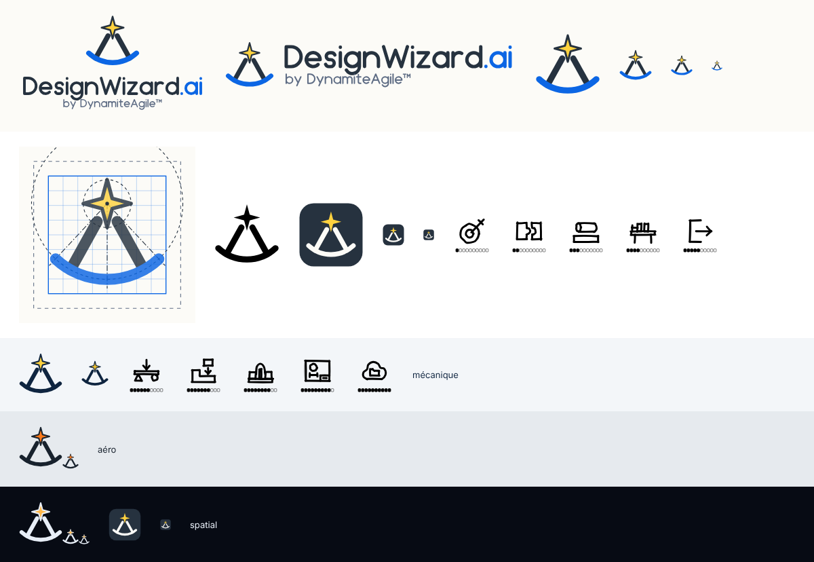
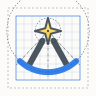
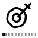
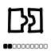
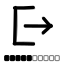
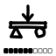
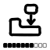
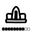
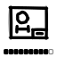
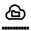

# DynamiteOrbit — charte de marque

> « De l'intention à la pièce, de la pièce au système — la conception mécatronique réinventée, ouverte. »
> DynamiteOrbit by DynamiteAgile™ — logiciel libre, licence MIT.

Tout ce qui suit est **généré ou tokenisé** : les images sortent de `python3 tools/make_sketch_assets.py` (bibliothèque standard,
résultat identique à chaque exécution), les couleurs et les formes sont des jetons CSS (`web/css/app.css`, `web/css/themes.css`).
On ne retouche jamais un SVG à la main. Aucune ressource externe : ni police web, ni CDN, ni script dans les SVG, ni `<text>`.

## 1. Le logo : l'éclair mis en orbite

Le 22 novembre 2026, DesignWizard.ai devient **DynamiteOrbit**, de la famille DynamiteAgile (« de la mine souterraine vers le ciel » :
on bâtit la fusée en plein vol vers les étoiles). La planche d'identité v1 a proposé trois pistes ; JP a dit « commençons avec les
éléments actuels, on finetunera » et la piste C a été prise d'office, facile à changer.

| Piste | Idée | Verdict |
|---|---|---|
| A. La mèche qui monte | Le carré jaune de DynamiteAgile ; l'éclair devient une trajectoire qui finit en étincelle. | Gardée en réserve : la plus proche du parent, au risque de confondre les deux produits en petit. |
| B. L'astre et son anneau | Un cercle jaune entouré d'un anneau violet, l'étincelle qui y monte. | Gardée en réserve : la plus à part, mais une image courante dans le spatial. |
| **C. L'éclair mis en orbite** | Le carré jaune et l'éclair de DynamiteAgile, plus petits, au centre ; une orbite bleue passe derrière puis devant, avec son étincelle orange. | **Retenue** : la charge utile de la famille, mise en orbite ; lisible à 16 px. |

L'ancien symbole (le compas-chapeau de sorcier de DesignWizard.ai) est retiré ; son histoire reste dans l'historique du dépôt.

### Construction (grille de 64, module 8)

- **Orbite** : ellipse de centre (32 ; 32), demi-axes 29 et 12, inclinée de −28°, trait bleu `#0c66e4` de 4, bouts ronds ; la moitié
  du haut passe derrière le carré, celle du bas devant.
- **Carré** : (15 ; 15), 34 × 34, coins de rayon 6, jaune `#ffd23f`, bord graphite `#26323f` de 4.
- **Éclair** : celui de DynamiteAgile, réduit de 0,62 autour du centre, trait graphite de 3,6.
- **Étincelle** : étoile à quatre branches sur l'orbite (paramètre 30°), rayon 6,4, orange `#e0602f` (le « Dynamite » de la famille).
- **Zone de protection** : un module (8 unités, soit 1/8 du côté) tout autour — le cadre en tirets de la figure.
- **Tailles minimales** : symbole 16 px ; logotype horizontal 24 px de haut ; sous 24 px, utiliser `favicon.svg`.
- **Lettrage** : « DynamiteOrbit » et « by DynamiteAgile™ » sont tracés en lettrage technique à trait unique (hauteur de capitale 10,
  hauteur d'x 7, panses de rayon 3,5 — `GLYPHS` dans `tools/sketch_logo.py`) : pas de police, donc le même rendu partout.

### Fichiers

| Fichier | Usage |
|---|---|
| `web/img/logo/mark.svg` (= `web/img/brand.svg`) | Symbole en couleur : carré jaune `#ffd23f` au bord graphite `#26323f`, orbite bleue `#0c66e4`, étincelle orange `#e0602f`. Fonds clairs et sombres. |
| `web/img/logo/mark-mono.svg` | Symbole en `currentColor` : gravure, tampon, fonds colorés ou sombres. |
| `web/img/logo/wordmark.svg`, `stacked.svg` | Logotype horizontal et empilé. |
| `web/img/favicon.svg` | Symbole inversé sur pastille graphite : lisible sur onglets clairs et sombres. |
| `web/img/icons.svg#i-logo` | Symbole dans le sprite : `currentColor` + `var(--acc)` pour l'étincelle — suit le thème et la brique active. |
| `web/img/og.svg`, `og.png` | Carte sociale 1200 × 630. |

### À faire / à ne pas faire

- **Oui** : symbole seul dès que la place manque ; version mono sur toute couleur ; étincelle à la couleur d'accent de la brique.
- **Non** : déformer, incliner, ombrer ou détourer le symbole ; changer l'angle des branches ; remplacer le lettrage par une police ;
  placer le symbole couleur sur un fond sombre (prendre `mark-mono` ou `i-logo`) ; ajouter un visage, un personnage ou un portrait ;
  rapprocher un autre logo dans la zone de protection ; écrire le nom du produit avec le nom d'une personne.

## 2. Thèmes et jetons

Le thème est `document.documentElement.dataset.theme` : `carnet` (défaut, aussi sans attribut), `mecanique`, `aero`, `spatial`.
`themes.css` se charge après `app.css` et ne redéfinit que des jetons, plus quelques détails propres à chaque thème en fin de fichier.

| Thème | Idée | Signes |
|---|---|---|
| **Le.Carnet** (`carnet`) | Le carnet d'ingénieur de la maison DynamiteAgile™. | Papier quadrillé, graphite, surligneurs, rectangles tracés à la main, ombres décalées. |
| **Mécanique** | Le bureau d'études. | Calque, quadrillage 24/120, bleu ISO, filets de 1 px, angles de 3 px, titres encadrés d'une ligne de cote. |
| **Aéro** | Le hangar et la planche de bord. | Aluminium clair, lignes de rivets, orange signal + bleu ciel, petites étiquettes en capitales façon pochoir. |
| **Spatial** | La salle de contrôle, de nuit. | Thème sombre, ambre et cyan de télémétrie, filets lumineux ; contrastes AA vérifiés. |

### Couleurs principales

| Jeton | carnet | mecanique | aero | spatial |
|---|---|---|---|---|
| `--bg` / `--paper` | `#fcfbf7` | `#f3f6f9` | `#e6eaee` | `#070b14` |
| `--surface` | `#ffffff` | `#ffffff` | `#f7f9fa` | `#0f1726` |
| `--surface-2` | `#f1f2f4` | `#e8edf2` | `#d9dfe5` | `#19243a` |
| `--ink` | `#172b4d` | `#0f2540` | `#18222d` | `#e7eef7` |
| `--muted` | `#5e6c84` | `#55667c` | `#4c5967` | `#9db0c8` |
| `--line` | `#dcdfe4` | `#c5d0db` | `#b8c2cc` | `#2a3b57` |
| `--graphite` | `#26323f` | `#1c3350` | `#2b3743` | `#c9d7e8` |
| `--primary` | `#0c66e4` | `#0057a8` | `#0a6cb4` | `#58c4ff` |
| `--primary-strong` | `#0b3f8f` | `#003a73` | `#074c80` | `#1c7fb8` |
| `--on-primary` | `#ffffff` | `#ffffff` | `#ffffff` | `#04121f` |
| `--danger` / `--warn` / `--ok` | `#ae2e24` `#9a6512` `#216e4e` | `#b3261e` `#8a5a00` `#17694a` | `#b02a1e` `#855000` `#1d6a46` | `#ff8f85` `#ffc55c` `#6fe3a6` |
| `--on-acc` | `#0b1b33` | `#081a30` | `#0c141c` | `#07101c` |
| `--hl-yellow` | `#ffd23f` | `#f2c230` | `#ffc024` | `#ffb84a` |
| `--hl-orange` | `#ff8a3d` | `#ee8a32` | `#ff7a1a` | `#ff8f4a` |
| `--hl-cyan` | `#3ec6e0` | `#35b3d4` | `#3fc0e6` | `#4fd8ea` |
| `--hl-green` | `#5fd08a` | `#46b97c` | `#52c47e` | `#5fe09a` |
| `--hl-pink` | `#ff6f91` | `#e9708f` | `#f0718f` | `#ff7fa8` |
| `--hl-violet` | `#9b7bff` | `#8a7df0` | `#9184f2` | `#a996ff` |
| `--hl-blue` | `#4d8dff` | `#3d86e6` | `#46a2ee` | `#6aa8ff` |
| `--hl-teal` | `#2ec4b6` | `#25ad9f` | `#2bb8a9` | `#3fd4c0` |
| `--hl-red` | `#ff5a4f` | `#e8554b` | `#f0584a` | `#ff6b5f` |

### Liste complète des jetons (`:root` de `app.css`)

- **Surfaces et encres** : `--bg --paper --surface --surface-2 --sheet --ink --ink-strong --ink-soft --muted --line --grid --graphite`.
- **Actions et états** : `--primary --primary-strong --primary-hover --on-primary --danger --warn --warn-ink --ok --info`,
  fonds doux `--ok-soft --warn-soft --danger-soft --info-soft`, `--violet-ink --teal-ink` (badges A/B), `--path --path-ink` (chemins d'isolation).
- **Accents** : les neuf `--hl-*`, `--acc` (accent de la brique active, posé par `html[data-module]`), `--on-acc` (texte sur un accent plein),
  `--on-graphite`, `--note --note-soft` (infobulles, étiquettes 3D, encadrés), `--overlay` (fond de fenêtre modale).
- **Formes** : `--r-hand --r-card --r-field --r-small`, `--wobble` (1 = inclinaisons « crayon », 0 = droit),
  `--shadow-small --shadow-sketch --shadow-pop --shadow-modal`, `--rule-img --sep-img` (filet de la barre du haut, séparateur d'onglets).
- **Images** : `--empty-img` (état vide), `--img-filter` (logos de module ; inversés en `spatial`), `--scroll-thumb --scroll-track`.
- **Vue 3D** : `--view-bg --view-edge --view-grid --view-part --view-select` — le fond est peint par le CSS (`.viewport`), les autres sont
  lus par le viewer via `getComputedStyle(document.documentElement)`.
- **Lettrage** : `--font --hand --mono --label-font --label-track`. `color-scheme` est défini par thème (`dark` pour `spatial`).

**Contraste.** Pour chaque thème, le texte sur chaque surface, les états, `--on-primary` sur `--primary`, `--on-acc` sur chacun des neuf
`--hl-*` et le texte sur les teintes à 45 % sont ≥ 4,5 : 1 (mesure : thème chargé dans Chromium, luminance WCAG des valeurs calculées).

### Ajouter un thème

1. Dans `themes.css`, copier un bloc `html[data-theme="…"]` et redéfinir **tous** les jetons de couleur, `color-scheme`, les rayons,
   les ombres, `--wobble`, `--hand`, `--label-*` et les cinq `--view-*`. Ne jamais écrire une couleur hors d'un bloc de jetons.
2. Ajouter le thème au sélecteur commun des thèmes « construits » s'il n'a pas le tremblé du crayon ; ses détails propres vont en fin de fichier.
3. Vérifier AA (texte, états, les neuf accents avec `--on-acc`), les formulaires, menus, infobulles, tableaux, badges, fenêtres et barres de défilement.
4. Si le thème est sombre : `--img-filter` pour les logos de module, une variante `empty-<thème>.svg`, et une illustration
   `hero-<thème>.svg` (`THEMES` dans `tools/sketch_themes.py`).
5. Captures d'écran dans `docs/img/brand/theme-<thème>.png` ; ajouter la ligne au tableau ci-dessus et la carte dans `web/vitrine.html`.

## 3. Brique par brique

Dix briques, dix emblèmes (`web/img/bricks/bN.svg`, 64 × 64, `currentColor` ; aussi `icons.svg#i-bN`). Sous le pictogramme, une rangée de
dix cases : les N+1 premières sont pleines. L'« esprit » est une inspiration de méthode — voir la règle d'inspiration.

| Brique | Emblème | Accent | Esprit | Une ligne de voix |
|---|---|---|---|---|
| B0 Intention |  cible et crayon | `--hl-yellow` | Les carnets d'étude de Léonard de Vinci | « Dites ce que la pièce doit faire ; on dessinera après. » |
| B1 Interfaces |  deux pièces qui s'emboîtent | `--hl-violet` | Euler : repères et liaisons | « Ce qui se touche se décide en premier. » |
| B2 Matière & procédé |  barre et plaque | `--hl-teal` | Archimède : la matière pesée et mesurée | « Le brut et la gamme donnent la forme. » |
| B3 Pièce (Atelier) |  établi et étau | `--hl-blue` | L'atelier des frères Wright : essayer, corriger | « Une opération à la fois, comme à l'établi. » |
| B4 Artéfacts |  flèche de sortie | `--hl-cyan` | Ada Lovelace : le programme comme objet | « Des fichiers ouverts, relisibles, versionnés. » |
| B5 Physique |  poutre chargée | `--hl-green` | Bernoulli et Euler : la poutre en une ligne | « 80 % de la réponse, avec ses hypothèses. » |
| B6 Assemblage |  pièce qui se pose | `--hl-orange` | Gustave Eiffel : l'ouvrage pensé en pièces | « Les interfaces deviennent des liaisons. » |
| B7 Isolation & DFx |  chemin au-dessus d'une nervure | `--hl-red` | Nikola Tesla : le respect de la haute tension | « Mesuré sur le 3D, comparé à la norme. » |
| B8 Dessins & rapport |  feuille cotée | `--hl-pink` | Gaspard Monge : la géométrie descriptive | « Un dessin que l'atelier peut signer. » |
| B9 Échange ouvert |  dossier dans un nuage | `--hl-blue` | L'Encyclopédie de Diderot et d'Alembert | « Vos données sortent, sans verrou. » |

Illustrations d'accueil : `web/img/sketch/hero-carnet.svg` (le parcours), `hero-mecanique.svg` (planche à dessin), `hero-aero.svg`
(hangar), `hero-spatial.svg` (orbite) — le brut, la pièce en cours dans l'étau, la pièce finie et ses interfaces repérées I, II, III.

## 4. Typographie

Polices du système uniquement. `--font` (texte) : Segoe UI Variable, system-ui… ; `--hand` (titres) : écriture manuscrite en `carnet`,
grotesque étroite type normographe en `mecanique` et `aero`, grotesque large en `spatial` ; `--mono` : valeurs, codes, raccourcis ;
`--label-font` : petites étiquettes en capitales (pochoir en `aero`, mono en `spatial`). Interface en français, termes techniques en
anglais quand ils sont l'usage (creepage, clearance, DFM, STEP, FeatureScript).

## 5. Icônes, logos de module, illustrations

- **Icônes** : grille 24, trait `currentColor` de 1,75, bouts ronds, second passage de crayon à 38 % ; coordonnées entre 2,5 et 21,5.
  `<svg class="sk-icon"><use href="img/icons.svg#i-NOM"/></svg>`. `icons-crisp.svg` porte les mêmes identifiants sans tremblé, pour
  les thèmes construits. On ajoute une forme dans `ICONS` (`tools/sketch_icons.py`), jamais dans le sprite.
- **Logos de module** (`web/img/marks/<clé>.svg`, 160 × 124) : une tache de surligneur derrière un dessin au graphite ; `ART` et `MARKS`
  dans `tools/sketch_marks.py`.
- Aucun texte dans une image : les lettres (le « i », le « ! ») sont des traits ; les repères se comptent en bâtons.

## 6. Voix

Celle d'un chef d'atelier qui explique : phrases courtes, verbes d'action, tutoiement proscrit, vouvoiement simple. On dit ce que fait
l'outil et ce qu'il ne fait pas (« indicatif : la décision appartient à la revue »). Pas de superlatifs, pas de jargon d'IA ; l'IA
« aide », elle ne « décide » pas. Les chiffres portent leur unité et leur hypothèse.

## 7. Règle d'inspiration

« Inspiré des meilleurs inventeurs » veut dire **s'inspirer d'une méthode**, jamais emprunter une image ou un nom.

1. **Aucun portrait ni ressemblance** d'une personne réelle, aucun logo ni marque d'une entreprise, **aucun nom de personne vivante**,
   nulle part.
2. L'inspiration est **stylistique** : études de carnet de la Renaissance (compas, cercles de proportion), résonance électrique
   (bobines, arcs, lignes de champ), clarté des premiers principes, simplicité radicale.
3. Les noms de figures historiques **décédées depuis plus de 70 ans** (Léonard de Vinci, Nikola Tesla, Archimède, Euler, Bernoulli,
   Ada Lovelace, les frères Wright, Tsiolkovski, Monge, Eiffel, Diderot…) n'apparaissent que comme légende « esprit », dans ce document
   et dans la vitrine — **jamais** dans le logo, le nom du produit, un nom de module ou une image.
4. Le pictogramme « cloud » est un dossier dans un nuage : il ne reprend le logo d'aucun service.

Captures de référence : `docs/img/brand/theme-carnet.png`, `theme-mecanique.png`, `theme-aero.png`, `theme-spatial.png`,
`vitrine.png`, `vitrine-mobile.png`, `logo-sheet.png`.

## La marque sur chaque document

Tout document qui sort de la plateforme dit qui l'a fait. Les mots viennent d'une seule source,
`web/js/core/brand.js` — la formulation est celle de DynamiteAgile :

> DynamiteOrbit™ by DynamiteAgile™ · Co-Intelligence WorkFlow™ — document généré par DynamiteOrbit. La version
> électronique fait foi ; la version imprimée est pour référence.

| Document | Le visuel | La note |
|---|---|---|
| Rapports et gammes en **PDF** (`core/pdfdoc.js`) | Symbole et nom sur la page de titre ; symbole, « DynamiteOrbit™ by DynamiteAgile™ » et titre en tête de chaque page | Au pied de chaque page, page de titre comprise |
| Rapports et gammes en **Word** (`core/docx.js`) | En-tête de chaque page : symbole, nom, document, référence, révision, date, page | Pied de chaque page |
| Classeurs **Excel** des calculs (`core/xlsx.js`) | Symbole et ligne de la marque en tête de chaque feuille | Au pied de chaque feuille imprimée, dans la feuille Notice et dans les propriétés du fichier |
| **Dessins** PDF et SVG (`draw/drafting3.js`) | Symbole, nom et maison dans le cartouche | Sous le cadre de chaque feuille |
| Revue de conception en **HTML** | Symbole et nom en tête | Bas de page |
| **Présentation** (`web/presentation.html`, et son PDF) | Logotype de la couverture | Au pied de chaque page |
| Texte, Markdown, **CSV** (ouvert dans un tableur), `.dwiz`, **FeatureScript** | — | Dernière ligne, écrite comme un commentaire du format (une dernière cellule pour un CSV) |
| **DXF** | — | Commentaire de groupe 999 en tête, en ASCII |
| **STEP** | — | Commentaire `/* … */` après la première ligne, en ASCII |
| **STL** binaire | — | Les 80 octets d'en-tête |
| **Gerber**, perçage Excellon, netlist IPC-D-356 | — | `G04 …*`, `; …`, `C  …` : le commentaire de chaque format |
| draw.io, XML, SVG | — | Commentaire XML après le prologue |
| **JSON** (projet, arbre des fonctions) | — | Première clé `_mark` ; elle est retirée quand le fichier revient |
| Arbre de travail dans **Google Drive** | — | Chaque fichier texte, à l'écriture (`google/drive_fs.js`) |
| **Onshape** | — | Le STEP importé, et la dernière ligne du bloc de notes du dessin natif |

Deux garde-fous : `download()` (`core/dom.js`) marque tout fichier texte qui sort, quel que soit l'écran qui l'a écrit, et
un test refuse qu'un écran enregistre un fichier par un `Blob` à lui. La note est écrite **une fois** : un fichier
déjà marqué ressort tel quel. Elle est toujours un commentaire du format : les lecteurs de la plateforme (`.dwiz`,
Gerber, DXF) relisent les fichiers marqués, c'est testé.

Ce qui ne porte pas la note : une **capture PNG** de la vue 3D (une image, sans texte) et `acces.json` (un réglage du
site, pas un document). La plateforme n'écrit ni `.pptx` ni `.xlsx` : la présentation est une page et son PDF, les
tableaux sortent en CSV.

## Le gabarit des documents à lire

Les rapports, les gammes et le dossier de revue (PDF et Word) suivent un même gabarit, dans l'esprit du gabarit
d'ingénierie de DynamiteAgile, avec le visuel de DynamiteOrbit :

- **Sur chaque page**, un cartouche d'en-tête encadré : le symbole et « DynamiteOrbit™ by DynamiteAgile™ » ; le titre
  et le genre du document (RAPPORT DE REVUE DE CONCEPTION, GAMME…) ; le n° de document, la révision, la date et la page
  « n de N ». Dessous, la ligne d'extraction (« Extrait le … — DynamiteOrbit v… ») et le projet.
- **Sur la première page** : le titre, les faits du document, le bloc **Approbation** (préparé par, vérifié par,
  approuvé par — nom, date, signature) et le **Journal des révisions** (révision, motif, sections touchées, nom, date).
  Le sommaire suit.
- **Au pied de chaque page** : la **note de confidentialité** du projet, en gras, puis la note de la plateforme.

Les noms du bloc d'approbation, l'**organisation** et la note de confidentialité se règlent une fois, dans le
cartouche de l'écran Dessins (`project.drawing`) : ils servent aux dessins comme aux documents (`docIdentity`,
`confidentialNote` dans `core/brand.js`). Sans texte propre au projet, la note est : « CONFIDENTIEL — ce document et
les informations qu'il contient sont la propriété de *l'organisation* (ou « son émetteur »). Toute reproduction,
diffusion ou utilisation sans son autorisation écrite est interdite. » Les dessins la portent sous leur cadre, au-dessus
de la note de la plateforme, et l'organisation dans leur cartouche.

Le **dossier de revue de conception** sort en PDF et en Word à ce gabarit (boutons « PDF » et « Word » de l'écran
Rapport) : il est lu sur ce que l'écran montre, bloc par bloc (`core/dom_doc.js`) — titres, textes, tableaux aux
colonnes larges comme ce qu'elles disent, chiffres clés, images. L'impression du navigateur reste possible, mais elle
ne porte ni cartouche ni pagination de la maison.
